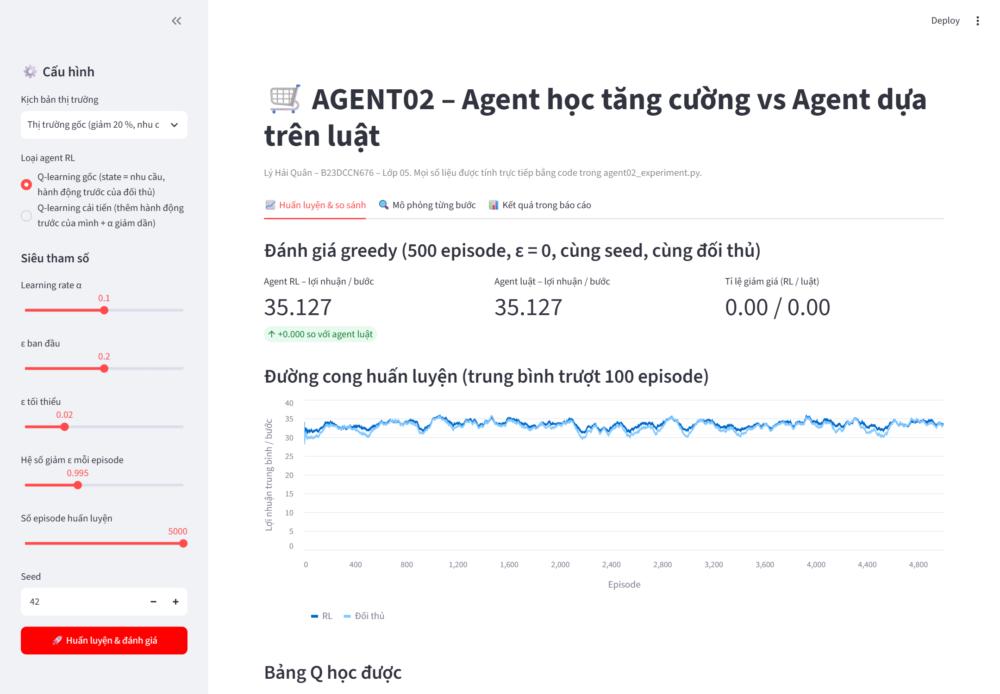
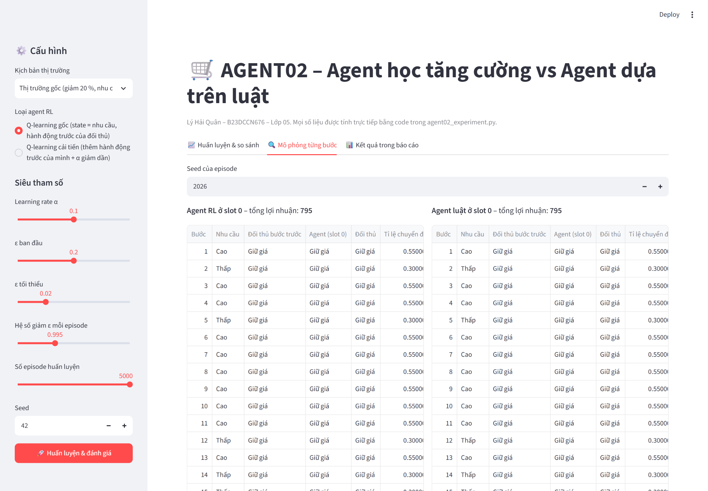
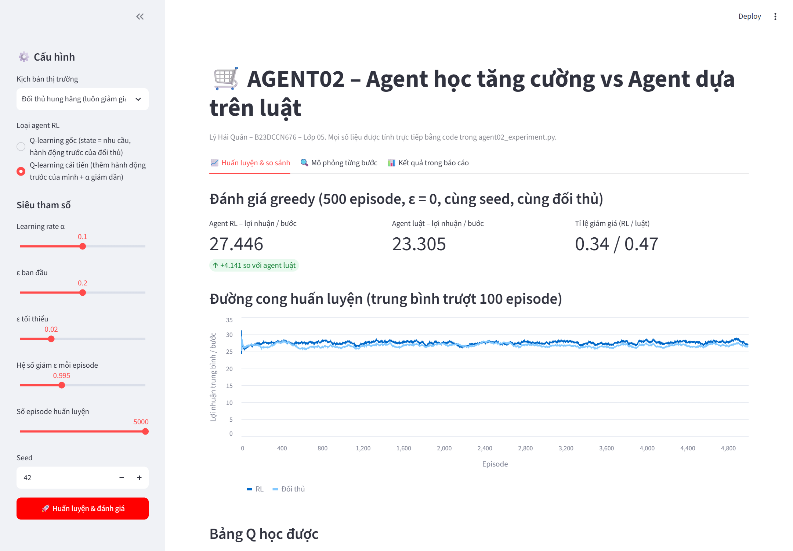

# AGENT02 – Agent học tăng cường vs Agent dựa trên luật

**Phát triển Hệ thống Thông minh (2026–2027)**
Sinh viên: **Lý Hải Quân** – MSSV **B23DCCN676** – Lớp **05** – Bài cá nhân

> 📄 Báo cáo: [Tiếng Việt (PDF)](report/agent02_05_LyHaiQuan_vi.pdf) · [English (PDF)](report/agent02_05_LyHaiQuan.pdf)



---

## 1. Bài toán

Hai cửa hàng online cùng bán một loại sản phẩm. Ở mỗi bước, mỗi cửa hàng chọn:

- **0 – Giữ giá** (giá 10, lãi 5 mỗi đơn), hoặc
- **1 – Giảm giá 20 %** (giá 8, lãi 3 mỗi đơn, nhưng có nhiều khách mua hơn và kéo khách của đối thủ).

Mỗi cửa hàng quan sát **nhu cầu hiện tại (thấp/cao)** và **hành động bước trước của đối thủ**. Mục tiêu là tối đa lợi nhuận.

Bài so sánh hai cách xây dựng agent:

| | Agent A – Học tăng cường | Agent B – Dựa trên luật |
|---|---|---|
| Phương pháp | Q-learning dạng bảng (8 giá trị Q), ε-greedy | 3 luật if-else cố định |
| Học từ kinh nghiệm | Có (100 000 bước huấn luyện) | Không |

## 2. Kết quả chính

| | Lợi nhuận / bước (5 seed) |
|---|---|
| Agent RL (Q-learning gốc) | 34.89 ± 0.31 |
| Agent dựa trên luật | 34.89 ± 0.31 |
| Tối ưu tính tay (giải tích) | 35.00 |

- **Thị trường gốc: hai agent hoà nhau.** RL tự học lại đúng chiến lược "không bao giờ giảm giá" của agent luật, và đây cũng là chiến lược tối ưu.
- **Đối thủ luôn giảm giá:** RL thắng agent luật (26.73 so với 23.16), vì luật cứng nhắc không thích nghi được.
- **RL không phải lúc nào cũng tốt hơn:** khi α = 0.5 hoặc ε = 0.30, hoặc trong một số thị trường sửa đổi, RL học ra chiến lược kém.
- **Agent cải tiến** (thêm *hành động trước của chính mình* vào trạng thái và dùng *learning rate giảm dần*) chỉ cách tối ưu tối đa 0.25 mỗi bước trong cả 4 môi trường.

Chi tiết và lời giải thích có trong báo cáo, gồm 10 câu hỏi của đề và các thí nghiệm A–E.

## 3. Cấu trúc thư mục

```
AI-Agent-assigment/
├── agent02_experiment.py     # Chương trình chính: môi trường, 2 agent, mọi thí nghiệm
├── demo_app.py               # Demo giao diện web (Streamlit)
├── requirements.txt          # Thư viện cần cài
├── run_log.txt               # Output console của lần chạy dùng trong báo cáo
├── agent02_results/          # Toàn bộ CSV, bảng Q và hình vẽ sinh ra khi chạy
└── report/
    ├── agent02_05_LyHaiQuan_vi.pdf   # Báo cáo tiếng Việt
    ├── agent02_05_LyHaiQuan.pdf      # Báo cáo tiếng Anh
    ├── report_vi.md / report.md      # Mã nguồn báo cáo (Markdown)
    ├── img/                          # Ảnh chụp màn hình demo
    ├── style.css
    └── build_pdf.sh                  # Script build PDF từ Markdown
```

### Các phần trong `agent02_experiment.py`

| Dòng | Thành phần | Nguồn |
|---|---|---|
| 1–1083 | `Config`, `ECommerceEnvironment`, `QLearningAgent`, `RuleBasedAgent`, `train_rl_against_rule`, `evaluate_pair`, các thí nghiệm 1–4 | Code mẫu của thầy (chỉ sửa nhỏ, có ghi chú) |
| 1084–1688 | Bảng 5 seed, hai agent cùng học, môi trường sửa đổi, `ImprovedQLearningAgent` | Phần mở rộng tự viết |
| 1689–1740 | `main()` | Code mẫu + gọi thêm phần mở rộng |

Các chỉnh sửa trên phần code mẫu **không làm thay đổi kết quả gốc**: chạy file gốc và file này đều ra RL 35.1275 / Luật 34.9685.

## 4. Cài đặt

Yêu cầu Python ≥ 3.10, không cần GPU.

```bash
git clone https://github.com/lyhaiquan/AI-Agent-assigment.git
cd AI-Agent-assigment
pip install -r requirements.txt
```

## 5. Chạy thí nghiệm

```bash
python agent02_experiment.py
```

- Thời gian chạy khoảng **14 phút** trên CPU laptop.
- Kết quả được ghi vào thư mục `agent02_results/`.
- Mọi seed đều cố định nên chạy lại sẽ ra **đúng các con số trong báo cáo**:
  - baseline: seed môi trường 42, seed đánh giá 500 042;
  - nhiều seed: huấn luyện 11, 22, 33, 44, 55, đánh giá = seed + 800 000.

Đã kiểm thử với Python 3.14.2, NumPy 2.4.2, Matplotlib 3.11.1, Streamlit 1.66.1.

### Danh sách thí nghiệm và file kết quả

| # | Thí nghiệm | File trong `agent02_results/` |
|---|---|---|
| 1 | Baseline: huấn luyện RL đấu với agent luật, đánh giá greedy riêng (TN A, B) | `baseline_*.csv`, `q_tables.txt`, `episode_rewards.png` |
| 2 | Learning rate α ∈ {0.01, 0.10, 0.50} (TN C) | `learning_rate_comparison.*`, `learning_rate_curves.png` |
| 3 | Khám phá: 3 lịch giảm ε + ε cố định 0.05 / 0.30 (TN D) | `exploration_comparison.*`, `exploration_curves.png`, `exploration_training_vs_eval.csv` |
| 4 | Nhiều seed (code mẫu) | `multi_seed_summary.csv` |
| A | Phần thưởng kỳ vọng tính giải tích | `expected_rewards.csv` |
| B | Đánh giá agent luật ở cùng vị trí với RL (so sánh công bằng) | `rule_vs_rule_evaluation.csv` |
| C | Bảng kết quả: mọi cấu hình × 5 seed (TN E) | `results_table.csv`, `results_table.png` |
| D | Hai Q-learner cùng học (câu 8) | `two_learners.csv`, `two_learners_curves.png`, `two_learners_q_tables.txt` |
| E | Môi trường sửa đổi: giảm 10 %, nhu cầu lưu trì, đối thủ hung hăng (câu 9) | `modification_experiment.*` |
| F | Agent cải tiến + ablation (câu 10) | `improved_agent.csv` |

## 6. Chạy demo giao diện

```bash
streamlit run demo_app.py
```

Trình duyệt mở tại **http://localhost:8501**.

| Phần | Chức năng |
|---|---|
| Thanh bên trái | Chọn kịch bản thị trường, loại agent RL (gốc / cải tiến), α, lịch ε, số episode, seed, rồi bấm **Huấn luyện & đánh giá** |
| Tab *Huấn luyện & so sánh* | Lợi nhuận mỗi bước của RL và agent luật (cùng seed, cùng đối thủ), đường cong huấn luyện, bảng Q |
| Tab *Mô phỏng từng bước* | Chạy lại 1 episode 20 bước, RL và agent luật đặt cạnh nhau, tô màu các bước giảm giá |
| Tab *Kết quả trong báo cáo* | Bảng 5 seed, ablation câu 10 và các hình chính |

Demo import trực tiếp các class trong `agent02_experiment.py` nên số liệu khớp với báo cáo. Với cấu hình mặc định, demo ra 35.127 cho cả hai agent.

<p align="center">
  
  
</p>

## 7. Build lại báo cáo PDF

```bash
bash report/build_pdf.sh
```

Cần cài `pandoc` và Microsoft Edge hoặc Google Chrome (không cần LaTeX). Script sẽ tạo lại cả hai file PDF tiếng Việt và tiếng Anh.

## 8. Tài liệu tham khảo

- Đề bài *Laboratory Experiment 02* và tài liệu *AGENT02: Python Implementation* của môn học.
- R. S. Sutton & A. G. Barto, *Reinforcement Learning: An Introduction*, 2nd ed., MIT Press, 2018.
- L. Buşoniu, R. Babuška & B. De Schutter, "A comprehensive survey of multiagent reinforcement learning", *IEEE Trans. SMC-C*, 2008.
