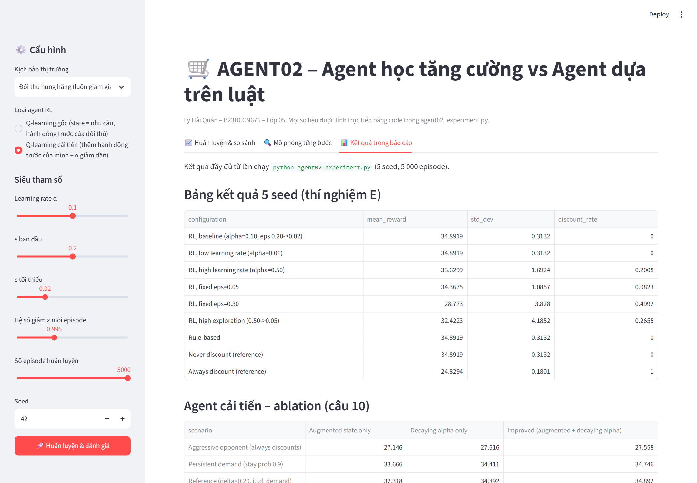

<div class="title-page">
<div class="big">Reinforcement-Learning-Based Agents versus Rule-Based Agents</div>
<div class="sub">Intelligent System Development, Academic Year 2026–2027</div>
<table>
<tr><td><b>Student</b></td><td>Lý Hải Quân</td></tr>
<tr><td><b>Student ID</b></td><td>B23DCCN676</td></tr>
<tr><td><b>Class</b></td><td>05</td></tr>
<tr><td><b>Work arrangement</b></td><td>Individual</td></tr>
<tr><td><b>Submission</b></td><td>29 October 2026</td></tr>
<tr><td><b>Source code</b></td><td><a href="https://github.com/lyhaiquan/AI-Agent-assigment">https://github.com/lyhaiquan/AI-Agent-assigment</a></td></tr>
</table>
</div>

# 1. Introduction and objectives {.no-break}

Two sellers offer similar products in a simulated marketplace. At every time step each seller decides whether to give a 20 % discount. A discount raises the chance that a visitor buys, but it also cuts the profit on each sale, and it lowers the competitor's conversion rate.

We compare two ways of building the seller:

- **Agent A, reinforcement learning (RL).** Tabular Q-learning. The agent learns action values from the profit it receives.
- **Agent B, rule-based.** A fixed if-else policy written by a developer. It never changes.

The objectives are to model the problem as a multi-agent system, implement both agents, measure them under a fair and reproducible protocol, and explain *why* the results come out the way they do. That includes the cases where learning does not help.

**Main findings (details in Sections 5–7).**

1. In the reference market the trained RL agent and the rule-based agent obtain **exactly the same evaluation reward** (34.89 ± 0.31 per step over 5 seeds). On the visited states both policies reduce to "never discount", which the analytic calculation in Section 5.1 shows is the best policy against this opponent (35.0 per step in expectation).
2. Learning is fragile. A high learning rate (α = 0.5) or heavy exploration (fixed ε = 0.30) produce policies that discount too often and lose 1–6 units per step.
3. When the environment changes, the rule-based agent cannot adapt. Against an aggressive always-discount competitor the RL agent earns **26.73** against **23.16** for the rules. But the reference RL agent also *loses* to the rules in two modified markets, because its state does not contain its own previous action.
4. An improved Q-learner that adds its own previous action to the state and uses a decaying learning rate matches the rules where the rules are good and beats them where they are not (Section 6, Q10; demo in Section 7).

# 2. Environment and agents

## 2.1 Environment

| Element | Definition |
|---|---|
| Agents | 2 sellers, $i \in \{1,2\}$ (slot 0 = agent A, slot 1 = agent B in the code) |
| Local state | $s_i(t) = (d_t, c_i(t))$, demand $d_t\in\{0,1\}$ and competitor's previous action $c_i(t)\in\{0,1\}$; 4 states |
| Actions | $a_i(t)\in\{0 = \text{no discount}, 1 = \text{discount}\}$, chosen simultaneously |
| Visitors | $N_t = 10$ if $d_t = 0$, $N_t = 20$ if $d_t = 1$ |
| Conversion | $p_i(t) = \operatorname{clip}(0.30 + 0.25 d_t + 0.15 a_i(t) - 0.10 a_{-i}(t),\ 0.05,\ 0.95)$ |
| Sales | $S_i(t) \sim \text{Binomial}(N_t, p_i(t))$ |
| Reward (profit) | $r_i(t) = S_i(t)\,\big(P(1-\delta a_i(t)) - C\big)$ with $P = 10$, $C = 5$, $\delta = 0.20$ |
| Transition | $d_{t+1}$ drawn i.i.d. with $P(d=1) = 0.5$ (independent of actions); $c_i(t+1) = a_{-i}(t)$ |
| Episode | 20 steps; each episode starts with random demand and both previous actions = 0 |

```python
# ECommerceEnvironment.step (core of the reward model)
conversion = 0.30 + 0.25 * self.demand + 0.15 * own_action - 0.10 * competitor_action
conversion = float(np.clip(conversion, 0.05, 0.95))
sales = int(self.rng.binomial(customers, conversion))
effective_price = self.config.price * (1.0 - self.config.discount_rate * own_action)
profit = sales * (effective_price - self.config.unit_cost)
...
self.previous_actions = list(actions)   # becomes c_i(t+1)
self.demand = self.next_demand()        # i.i.d. in the reference model
```

## 2.2 Agent A: Q-learning

The agent keeps a table $Q[d, c, a]$ with $2\times2\times2 = 8$ entries, chooses actions $\varepsilon$-greedily during training, and updates

$$Q(s_t,a_t) \leftarrow Q(s_t,a_t) + \alpha\Big[r_t + \gamma \max_{a'} Q(s_{t+1},a') - Q(s_t,a_t)\Big].$$

At the last step of an episode the target is just $r_t$. $\varepsilon$ decays per episode as $\varepsilon_e = \max(\varepsilon_{\min}, \varepsilon_0 \cdot 0.995^{e})$, so it reaches its 0.02 floor after about 460 of the 5 000 episodes.

```python
def learn(self, state, action, reward, next_state, terminal=False):
    old_value = self.q[demand, competitor_previous_action, action]
    target = reward if terminal else reward + self.gamma * np.max(self.q[next_demand, next_competitor_action])
    self.q[demand, competitor_previous_action, action] = old_value + self.alpha * (target - old_value)
```

## 2.3 Agent B: rule-based

$$\pi^{\text{rule}}(d,c) = \begin{cases}0 & d = 0\\ 1 & d = 1,\ c = 1\\ 0 & d = 1,\ c = 0\end{cases}$$

```python
class RuleBasedAgent:
    def act(self, state, explore=False):
        demand, competitor_previous_action = state
        if demand == 0:
            return 0                                   # Rule 1: low demand -> no discount
        elif demand == 1 and competitor_previous_action == 1:
            return 1                                   # Rule 2: match a competitor's discount
        else:
            return 0                                   # Rule 3: otherwise no discount
```

## 2.4 Why this is a multi-agent system

Each seller's reward depends on the other seller's *current* action (the $-0.10\,a_{-i}$ term), and its next observation contains the other seller's action ($c_i(t+1) = a_{-i}(t)$). Neither agent controls the whole environment, and neither sees the other's action before choosing. This is a two-player stochastic game, not a single-agent Markov decision process. In particular, the rule-based opponent *reacts* to the RL agent: if A discounts in high demand, B discounts at the next high-demand step. That reaction drives most of the results below.

# 3. Experimental setup

**Source code, raw results and demo:** <https://github.com/lyhaiquan/AI-Agent-assigment>. The full program is [`agent02_experiment.py`](https://github.com/lyhaiquan/AI-Agent-assigment/blob/main/agent02_experiment.py); every CSV and figure used below is in [`agent02_results/`](https://github.com/lyhaiquan/AI-Agent-assigment/tree/main/agent02_results); the console output of the run is [`run_log.txt`](https://github.com/lyhaiquan/AI-Agent-assigment/blob/main/run_log.txt).

## 3.1 Parameters

| Parameter | Value |
|---|---|
| Training episodes × steps | 5 000 × 20 = 100 000 steps per run |
| Evaluation episodes × steps | 500 × 20 = 10 000 steps per run |
| Learning rate α | 0.10 (also 0.01, 0.50) |
| Discount factor γ | 0.90 |
| Exploration | ε 0.20 → 0.02, decay 0.995 per episode (plus alternatives, Exp. D) |
| Price / cost / discount | 10 / 5 / 20 % |
| Seeds, baseline | environment 42; RL agent seed + 10 000; evaluation environment 500 042 |
| Seeds, multi-seed | training 11, 22, 33, 44, 55; evaluation = training seed + 800 000 |
| Software | Python 3.14.2, NumPy 2.4.2, Matplotlib 3.11.1; whole run ≈ 14 min on a laptop CPU |

## 3.2 Evaluation protocol

- **Separate evaluation phase.** After training the Q-table is frozen, ε = 0 (greedy), and evaluation uses a different environment seed from training.
- **Same slot, same opponent, same seed.** The reference code reports the RL agent in slot 0 and the rule agent in slot 1, so the two face *different* opponents. For a fair comparison we also evaluate the rule-based policy *in slot 0*, against the same rule-based opponent, with the same evaluation seed (`run_rule_vs_rule`, `multi_seed_fixed`). Every "Rule-based" number in our tables is this slot-0 number.
- **Multiple seeds.** Every configuration in the results table is trained and evaluated on 5 independent seeds. We report mean and sample standard deviation of the evaluation reward per step.

```python
def evaluate_pair(config, rl_agent, episodes=None, seed=900_000, opponent=None, names=("RL", "Rule-based")):
    env = ECommerceEnvironment(config, seed=seed)          # separate evaluation seed
    rule_agent = RuleBasedAgent() if opponent is None else opponent
    for episode in range(episodes):
        states = env.reset()
        for _ in range(config.steps_per_episode):
            rl_action = rl_agent.act(states[0], explore=False)   # greedy, no Q update
            rule_action = rule_agent.act(states[1])
            next_states, rewards, info = env.step([rl_action, rule_action])
            ...
```

## 3.3 Changes to the reference code

All changes are additive and documented in the file header. **The reference baseline is reproduced exactly.** We ran the unmodified reference file and our file and got the same numbers (RL 35.1275, rule 34.9685; multi-seed RL 34.8919 ± 0.3132, rule 34.9321 ± 0.2496).

1. `Config.demand_persistence` (default `None` = reference i.i.d. demand) for the Markov-demand experiment.
2. Extra fixed opponents `AlwaysDiscountAgent` and `NeverDiscountAgent`.
3. `evaluate_pair` accepts any policy in slot 0 and any opponent in slot 1.
4. The training log also records the RL discount rate per episode. The learning-rate and exploration experiments also save training curves.
5. New experiments: fixed-ε exploration, 5-seed results table, two simultaneous learners, modified environments, improved agent.

# 4. Results

## 4.1 Experiment A: baseline (seed 42)

| Agent (evaluation, 10 000 steps) | Total reward | Mean reward / step | Discount actions | No-discount actions |
|---|---|---|---|---|
| RL (slot 0) | 351 275 | **35.1275** | 0 | 10 000 |
| Rule-based (slot 1, faces RL) | 349 685 | 34.9685 | 0 | 10 000 |
| Rule-based in slot 0 (faces rule agent, same seed) | 351 275 | **35.1275** | 0 | 10 000 |

Learned Q-table (`q_tables.txt`):

| State $(d, c)$ | $Q(s,0)$ | $Q(s,1)$ | Greedy action | Visited in evaluation? |
|---|---|---|---|---|
| (0, 0) low demand, competitor did not discount | 228.30 | 178.85 | no discount | yes |
| (0, 1) low demand, competitor discounted | 177.99 | 207.21 | discount | **no** |
| (1, 0) high demand, competitor did not discount | 246.88 | 235.23 | no discount | yes |
| (1, 1) high demand, competitor discounted | 211.42 | 242.96 | discount | **no** |

**Observation.** The greedy policy contains "discount" in two states, yet the agent never discounted during evaluation.

**Explanation.** Every episode starts with both previous actions = 0. The rule agent only discounts after the RL agent has discounted in high demand, and the RL agent never discounts in states $(d, 0)$. So states $(0,1)$ and $(1,1)$ are **never reached** under greedy play. On the states that are reached, the RL policy equals the rule policy (no discount). Same seed plus same actions gives the same binomial draws, which is why both earn exactly 35.1275. The 0.16 gap in the reference output (35.13 vs 34.97) is **not a policy difference**. The two numbers belong to two different seats with different random sales draws.

The size of the Q-values (≈ 200–250) is consistent with γ = 0.9: a constant reward of 35 per step gives $35/(1-0.9) = 350$ for an infinite horizon, and less here because episodes stop after 20 steps.

## 4.2 Experiment B: learning during training


| Training episodes | RL reward / step | Rule opponent reward / step | RL discount rate | ε at start of window |
|---|---|---|---|---|
| 1–500 | 32.55 | 31.63 | 0.295 | 0.200 → 0.017 |
| 501–1 000 | 33.85 | 33.54 | 0.111 | 0.020 |
| 1 001–2 000 | 33.91 | 33.42 | 0.130 | 0.020 |
| 2 001–3 000 | 33.04 | 32.15 | 0.226 | 0.020 |
| 3 001–4 000 | 33.48 | 32.94 | 0.160 | 0.020 |
| 4 001–5 000 | 33.65 | 33.10 | 0.157 | 0.020 |

**Observation.** Reward rises during the first ~500 episodes while ε decays, then **fluctuates around 33–34 without a clear trend**. The per-episode standard deviation is about 5.2 throughout. Training reward stays about 1.5 below the greedy evaluation reward (35.13), and the training discount rate (≈ 0.16) stays far above ε/2 = 0.01.

**Explanation.** With ε = 0.02 the agent still takes a random discount now and then. When that happens in high demand, the rule opponent discounts at the next high-demand step. The RL agent then finds itself in a state $(d,1)$, where its greedy action is "discount", and a short price war continues until a low-demand step breaks it. These episodes lower the training reward. Evaluation starts every episode in $(d,0)$ with ε = 0, so it never triggers one. The flat, noisy curve therefore does **not** prove convergence. The training reward measures the *exploring* policy, while the evaluation measures the *greedy* policy.

## 4.3 Experiment C: learning rate (seed 1 042)


| α | Eval. reward / step | Eval. discount rate | Training reward, last 1 000 ep. (mean ± sd) | Greedy policy $(0,0),(0,1),(1,0),(1,1)$ |
|---|---|---|---|---|
| 0.01 | 35.2475 | 0.000 | 34.86 ± 4.92 | 0, 0, 0, 1 |
| 0.10 | 35.2475 | 0.000 | 33.99 ± 5.19 | 0, 0, 0, 1 |
| 0.50 | 28.5085 | 0.405 | 31.91 ± 5.46 | 0, 0, **1**, 0 |

- **α = 0.01.** Training reward sits at ≈ 27 for the first 3 000 episodes and then jumps to ≈ 35. A reward of 27 is exactly the analytic value of "discount in high demand only" (Section 5.1). Small steps let the agent stay locked in a self-reinforcing discount war for a long time. Once the estimates were corrected, it found the best policy and had the least noisy training reward.
- **α = 0.10.** Learns quickly (within ~500 episodes) but the training curve keeps swinging by ±1.5.
- **α = 0.50.** Every noisy sale count moves the Q-value half-way. The greedy action in the key state (1, 0) ended up as *discount*, which costs ≈ 6.7 per step in evaluation.

Over 5 seeds (Table 4.6), α = 0.01 and α = 0.10 give identical evaluation results (34.89 ± 0.31). α = 0.50 gives 33.63 ± 1.69: lower on average and five times more variable across seeds.

## 4.4 Experiment D: exploration (seed 2 042)


| Setting | ε start → min (decay) | Training reward, all ep. | Training reward, last 1 000 | Training discount rate, last 1 000 | Eval. reward / step |
|---|---|---|---|---|---|
| low | 0.05 → 0.02 (0.999) | 33.67 | 33.65 | 0.158 | 35.1045 |
| baseline | 0.20 → 0.02 (0.995) | 33.67 | 33.24 | 0.209 | 35.1045 |
| high | 0.50 → 0.05 (0.995) | 33.03 | 33.14 | 0.206 | 35.1045 |
| fixed 0.05 | 0.05 (no decay) | 33.12 | 32.71 | 0.225 | 35.1045 |
| fixed 0.30 | 0.30 (no decay) | 30.81 | 30.63 | 0.411 | **27.4464** |

On this seed, four settings evaluate to the same 35.1045: all of them never discount on the visited states. Fixed ε = 0.30 pays twice. Its training reward is ≈ 3 lower because 30 % of its actions are random, and its *greedy* policy is also bad (discount in 3 of 4 states, evaluation discount rate 0.81). Heavy random discounting keeps the rule opponent in "match the discount" mode, so the agent mostly experiences states where the competitor has just discounted. The values it learns belong to that price-war regime and generalise poorly to the calm market seen in evaluation. Over 5 seeds (Table 4.6): fixed 0.05 gives 34.37 ± 1.09, high schedule 32.42 ± 4.19, fixed 0.30 28.77 ± 3.83.

## 4.5 Reference multi-seed experiment

`multi_seed_summary.csv` (reference code): RL 34.8919 ± 0.3132, "Rule-based" 34.9321 ± 0.2496. The rule-based number here is the slot-1 agent playing *against the RL agent*, so it is not a comparison of the two policies in the same position. Our Table 4.6 uses the slot-0 value instead.

## 4.6 Experiment E: fair comparison over 5 seeds (results table)

All rows: trained on seeds 11–55, greedy evaluation in slot 0 against the rule-based opponent, evaluation seeds 800 011–800 055 (identical for every row).

| Agent / configuration | Mean reward / step | Std. dev. (5 seeds) | Discount rate |
|---|---|---|---|
| RL, baseline (α = 0.10, ε 0.20 → 0.02) | 34.892 | 0.313 | 0.000 |
| RL, low learning rate (α = 0.01) | 34.892 | 0.313 | 0.000 |
| RL, high learning rate (α = 0.50) | 33.630 | 1.692 | 0.201 |
| RL, alternative exploration: fixed ε = 0.05 | 34.368 | 1.086 | 0.082 |
| RL, alternative exploration: fixed ε = 0.30 | 28.773 | 3.828 | 0.499 |
| RL, alternative exploration: 0.50 → 0.05 | 32.422 | 4.185 | 0.266 |
| **Rule-based** | **34.892** | **0.313** | **0.000** |
| Never discount (reference policy) | 34.892 | 0.313 | 0.000 |
| Always discount (reference policy) | 24.829 | 0.180 | 1.000 |


**Important.** Four rows are identical to the last digit. This is not a coincidence or a copy error. On every seed these four policies choose "no discount" at every visited step. With the same evaluation seed they therefore see the same binomial sales draws. Their paired difference is exactly 0, and the standard deviation of 0.313 measures **environment noise between seeds**, not a difference in policy quality. The baseline RL agent learned the same behaviour as the rule-based agent. It did not learn a better one, because in this market there is no better one (Section 5.1).

# 5. Supporting analysis

## 5.1 Analytic expected rewards

Expected one-step reward $E[r] = N\,p\,(P(1-\delta a) - C)$ for the agent, given the competitor's *current* action (`expected_rewards.csv`):

| δ | Demand | Competitor now | $E[r \mid a=0]$ | $E[r \mid a=1]$ | Myopically better |
|---|---|---|---|---|---|
| 0.20 | low | no discount | 15.0 | 13.5 | no discount |
| 0.20 | low | discount | 10.0 | 10.5 | discount |
| 0.20 | high | no discount | 55.0 | 42.0 | no discount |
| 0.20 | high | discount | 45.0 | 36.0 | no discount |
| 0.10 | low | no discount | 15.0 | 18.0 | discount |
| 0.10 | low | discount | 10.0 | 14.0 | discount |
| 0.10 | high | no discount | 55.0 | 56.0 | discount |
| 0.10 | high | discount | 45.0 | 48.0 | discount |

Long-run reward per step against the **rule-based opponent** (demand i.i.d. 50/50). The opponent discounts at time $t$ only if $d_t = 1$ and *we* discounted at $t-1$:

| Our stationary policy | δ = 0.20 | δ = 0.10 | Measured (δ = 0.20) |
|---|---|---|---|
| Never discount | ½·15 + ½·55 = **35.0** | **35.0** | 34.89 (all good RL runs, rule agent) |
| Discount in low demand only | ½·13.5 + ½(½·45 + ½·55) = 31.75 | ½·18 + ½·50 = 34.0 | — |
| Discount in high demand only | ½·15 + ½(½·36 + ½·42) = 27.0 | ½·15 + ½(½·48 + ½·56) = 33.5 | ≈ 27 (α = 0.01, first 3 000 ep.) |
| Always discount | ½·13.5 + ½·36 = 24.75 | ½·18 + ½·48 = 33.0 | 24.83 |

The measured values agree with the hand calculations within sampling noise. Two conclusions follow:

- With δ = 0.20, **never discounting is optimal** against this opponent, and the rule-based agent already plays it on every reachable state. RL cannot beat the rules here. It can only match them.
- With δ = 0.10, a discount is better *in the current step* in every state (+1 to +4), but it still loses over time: it provokes the opponent's matching discount at the next high-demand step, which costs 8–11. A Q-learner can only see this if its state tells it whether it discounted last step, and the reference state $(d, c)$ does not.

## 5.2 Code extract for the extensions

```python
class ImprovedQLearningAgent(QLearningAgent):
    def observe(self, env, states):
        if self.augmented:                       # (demand, competitor_prev, own_prev)
            return states[0] + (env.previous_actions[0],)
        return states[0]

    def learn(self, state, action, reward, next_state, terminal=False):
        index = state + (action,)
        self.visits[index] += 1
        alpha = max(0.005, 1.0 / self.visits[index] ** 0.6) if self.decaying_alpha else self.alpha
        target = reward if terminal else reward + self.gamma * np.max(self.q[next_state])
        self.q[index] += alpha * (target - self.q[index])
```

# 6. Answers to the ten laboratory questions

## Question 1. Agent and environment modelling

- **Agents:** two sellers. Agent A is a Q-learner, agent B is rule-based. In Q8 both are Q-learners.
- **Environment:** the market. It generates demand, turns both prices into conversion probabilities, samples sales and pays profits.
- **State space:** $S = \{0,1\}\times\{0,1\}$, i.e. (demand, competitor's previous action), 4 states per agent. The state is *local*: an agent does not see its own previous action, the competitor's policy, or future demand.
- **Action space:** $A = \{0, 1\}$ (no discount / discount), chosen simultaneously.
- **Reward:** profit $r_i = S_i\,(10(1-0.2a_i) - 5)$, $S_i\sim\text{Bin}(N_t, p_i)$.
- **Transition:** $d_{t+1}$ i.i.d. Bernoulli(0.5); $c_i(t+1) = a_{-i}(t)$. Demand does not depend on actions. The competitor part of the state is determined entirely by the other agent's choice.

It is a **multi-agent system** because (i) each agent's reward depends on the other's simultaneous action through $-0.10\,a_{-i}$; (ii) each agent's next state is the other agent's action; (iii) the agents have separate goals (their own profit) and act without seeing each other's current choice. Treating the opponent as a fixed part of the environment is only valid while the opponent is fixed. Q8 shows what happens when it is not.

## Question 2. Learning-based versus rule-based decisions

| Aspect | RL agent (Q-learning) | Rule-based agent |
|---|---|---|
| Decision-making | $\arg\max_a Q(s,a)$ over learned values | Hand-written if-else on the state |
| Use of experience | Every transition updates one Q-value | None; behaviour fixed at design time |
| Adaptability | Can re-learn when the market changes (aggressive opponent: 26.73 vs 23.16), but only for what its state can represent | None; a developer must rewrite rules (e.g. matching discounts costs 4.6 per step against an always-discounting rival) |
| Data / compute | 100 000 training steps per run (a few seconds on a CPU); result depends on α, ε, seed | Zero training; O(1) per decision |
| Predictability | Varies by seed (std up to 4.2 per step for bad settings) | Deterministic, auditable |

**Rule-based preferable:** a shop with a clear, regulated pricing policy ("never undercut the list price in low season") where decisions must be explainable to managers or auditors, and there is little data. In our reference market the rules are already optimal and need no training at all.

**RL preferable:** a marketplace with many competitors whose strategies change (e.g. a new aggressive seller enters). A learner that keeps updating from profit data can find the best response without a developer re-deriving rules. Our aggressive-opponent experiment is a small example: the RL agent learns "discount in low demand, hold price in high demand" (+3.6 per step over the rules).

## Question 3. Q-learning update

$$Q(s,a) \leftarrow Q(s,a) + \alpha\big[\underbrace{r + \gamma\max_{a'}Q(s',a')}_{\text{TD target}} - Q(s,a)\big]$$

The bracket is the **temporal-difference error**: how much better or worse the observed outcome (immediate reward plus discounted value of the best next action) was than the current estimate. α decides what fraction of that error is absorbed. γ decides how much future profit counts relative to today's.

With $Q(s,a) = 4$, $\alpha = 0.1$, $r = 6$, $\gamma = 0.9$, $\max_{a'}Q(s',a') = 5$:

1. Discounted future value: $\gamma \max_{a'}Q(s',a') = 0.9 \times 5 = 4.5$
2. TD target: $r + 4.5 = 6 + 4.5 = 10.5$
3. TD error: $10.5 - 4 = 6.5$
4. Step: $\alpha \times 6.5 = 0.1 \times 6.5 = 0.65$
5. New value: $Q(s,a) = 4 + 0.65 = \mathbf{4.65}$

**Interpretation.** The outcome was much better than expected (target 10.5 vs estimate 4), so the estimate moves *towards* the target, but only 10 % of the way. One lucky transition does not overwrite past experience. If the same target kept appearing, Q would converge to 10.5. With α = 1 it would jump there immediately and be fully exposed to noise, which is what we saw with α = 0.5 in Q7.

## Question 4. Exploration and exploitation

ε-greedy picks a random action with probability ε (exploration, to collect data on actions whose value is uncertain) and the greedy action otherwise (exploitation, to collect reward). Results from Section 4.4 and Table 4.6:

| Setting | Training reward (last 1 000 ep., seed 2 042) | Evaluation, 5 seeds |
|---|---|---|
| Decaying 0.20 → 0.02 (baseline) | 33.24 | 34.89 ± 0.31 |
| Fixed 0.05 | 32.71 | 34.37 ± 1.09 |
| Decaying 0.50 → 0.05 | 33.14 | 32.42 ± 4.19 |
| Fixed 0.30 | 30.63 | 28.77 ± 3.83 |

- **Too much exploration** (fixed 0.30) costs reward twice. During training, 30 % of actions are random (training reward ≈ 3 lower). It also distorts *what* is learned: frequent random discounts keep the reactive opponent in price-war mode, so the learned values describe that regime and the greedy policy discounts in 3 of 4 states (evaluation 27.45 on seed 2 042).
- **Stopping too early.** With ε fixed at a small value, the actions that look bad early on are rarely retried, so their Q-values stay stale. In our runs the visited part of the problem is small (4 states × 2 actions), so even ε = 0.05 found the right action on most seeds. But the low-exploration runs left the never-visited states $(0,1)$ and $(1,1)$ with arbitrary greedy actions (Q-table, Section 4.1). In a richer market such untested states would become real decision errors.
- The baseline schedule works best here: plenty of exploration early, then mostly exploitation.

## Question 5. Reward and business objectives

A discount raises conversion by 15 percentage points (more buyers) but lowers the price from 10 to 8 while the unit cost stays at 5:

- Without discount: profit per sale $= 10 - 5 = \mathbf{5}$.
- With discount: price $= 10 \times (1 - 0.20) = 8$, profit per sale $= 8 - 5 = \mathbf{3}$ (−40 %).

The margin falls by 40 %, but conversion only rises from 0.30 to 0.45 (+50 %) in low demand and from 0.55 to 0.70 (+27 %) in high demand. So the discount pays only in low demand *and* when the competitor is discounting at the same time (10.5 vs 10.0, Section 5.1). It also provokes the rule-based competitor. This is why the learned policy almost never discounts.

**Changing the reward changes the behaviour.** We tested this directly by setting δ = 0.10 (margin 4 instead of 3). Now the discount wins every one-step comparison, and the reference RL agent discounts 56 % of the time (Q9). Other plausible business rewards would push the policy the same way:

- revenue or market share ($r = S_i \cdot P_i$ or $r = S_i$) would reward discounting, since sales rise;
- a penalty for unsold inventory, or a bonus for customer acquisition, would also favour discounts;
- a penalty for "price war" episodes, or long-term brand value, would favour holding the price.

The agent optimises exactly the number it is given. The reward must encode the real business objective, or the agent will pursue the wrong one.

## Question 6. Performance evaluation

$\overline{R}_i = \frac{1}{T}\sum_t r_i(t)$ over the separate greedy evaluation ($T$ = 10 000 steps per seed):

| Agent | Seed 42 (single run) | 5 seeds, mean ± sd |
|---|---|---|
| RL agent (slot 0) | 351 275 / 10 000 = **35.13** | **34.89 ± 0.31** |
| Rule-based agent (slot 0, same seed & opponent) | 351 275 / 10 000 = **35.13** | **34.89 ± 0.31** |
| Rule-based opponent in slot 1 (reference output) | 349 685 / 10 000 = 34.97 | 34.93 ± 0.25 |

(Figure: Section 4.6.) Measured fairly, the two approaches are **tied**, and their behaviour on visited states is identical.

**Why one run is not enough.**

1. **Sampling noise.** Per-episode reward has a standard deviation of ≈ 4.8. The seed-to-seed standard deviation of the 10 000-step mean is 0.31, larger than the 0.16 gap that a single run (35.13 vs 34.97) would suggest.
2. **Training variance.** For some settings the learned policy itself changes from seed to seed (α = 0.5: 33.6 ± 1.7; high exploration: 32.4 ± 4.2). One lucky or unlucky seed can reverse the ranking.
3. **One market.** One run says nothing about other markets. In Q9 the ranking flips depending on the opponent and the discount size.

## Question 7. Learning rate and stability

| α | Eval. seed 1 042 | Eval. 5 seeds (mean ± sd) | Training sd (last 1 000 ep.) | Behaviour |
|---|---|---|---|---|
| 0.01 | 35.25 | 34.89 ± 0.31 | 4.92 | slow: stuck at ≈ 27 for 3 000 episodes, then the best and steadiest policy |
| 0.10 | 35.25 | 34.89 ± 0.31 | 5.19 | fast and adequate |
| 0.50 | 28.51 | 33.63 ± 1.69 | 5.46 | fast but unstable; wrong greedy action in state (1, 0) |

α is the weight of the newest TD error. A Q-value is roughly an exponentially weighted average of past targets with effective memory ≈ 1/α transitions: about 100 for α = 0.01, 10 for α = 0.1, 2 for α = 0.5. Profits are binomial, with a standard deviation of up to ≈ 11 per step in high demand. With α = 0.5 the estimate is essentially the last one or two samples, so the gap between the two actions (often only 1–13 units) is buried in noise and the greedy action flips. With α = 0.01 the noise is averaged out, but correcting a wrong early estimate takes thousands of updates, which is the long plateau at 27 in the figure. Higher α makes the agent more responsive to *real* change (useful if the market shifts) and more sensitive to *random* noise. Lower α does the reverse. The decaying α of the improved agent (Q10) gets fast early learning and low final noise.

## Question 8. Multi-agent interaction and non-stationarity

The other agent influences agent $i$ in two ways: through the **reward**, since its current discount lowers $p_i$ by 0.10 (≈ −10 profit in high demand), and through the **observation**, since its action becomes $c_i(t+1)$. A reactive opponent like the rule agent also makes $i$'s future depend on $i$'s own past action, which $i$ does not observe.

When **both agents learn at the same time**, each one's policy is part of the other's environment, so the transition and reward distributions each agent faces keep changing. Q-learning's convergence guarantee assumes a stationary MDP, and this one is not stationary. Each agent chases a moving target, and the pair can settle in different joint behaviours depending on the early random history.

**Experiment (Extension D).** Two independent Q-learners with identical hyper-parameters, trained simultaneously on 5 seeds, then evaluated greedily against each other:

| Seed | Learner 1 eval | Learner 2 eval | Discount rates (1 / 2) | Outcome |
|---|---|---|---|---|
| 11 | 34.74 | 34.83 | 0.00 / 0.00 | both hold price |
| 22 | 33.06 | 33.06 | 0.49 / 0.49 | both discount in low demand |
| 33 | 29.86 | 29.08 | 0.51 / 0.76 | discount war |
| 44 | 35.12 | 35.08 | 0.00 / 0.00 | both hold price |
| 55 | 34.60 | 34.74 | 0.00 / 0.00 | both hold price |


The same algorithm with the same settings reaches three qualitatively different outcomes. Three seeds settle on "both hold price" (≈ 35, the collusive-like outcome). Two seeds lock into discount equilibria and lose up to 6 per step each. The training-time discount rate of learner 1 barely falls (seed-average 0.31 in the first 500 episodes vs 0.25 in the last 500), so the agents keep perturbing each other long after ε has reached its floor.

**Changes that would help investigate this:** (a) freeze one learner for K episodes and then the other (alternating best response), and measure whether the joint policy stops changing; (b) put the opponent's recent action *frequency* or its identity into the state; (c) log the joint greedy policy every 100 episodes to measure how often it changes; (d) compare independent Q-learning against a joint-action learner, which learns $Q(s, a_i, a_{-i})$.

## Question 9. Limitations and robustness

Limitations of the reference simulation:

1. **Partial state.** The agent does not observe its own previous action, although the rule opponent reacts to it. The problem is therefore not Markov for the learner (Section 5.1).
2. **I.i.d. demand.** Demand has no persistence, seasonality or dependence on prices, so "high demand now" says nothing about the next step.
3. **Illustrative conversion model.** A linear, additive conversion formula, one discount level, homogeneous customers, no customer switching between shops (the competitor's discount *lowers* our conversion but does not move customers to them in a conserved way).
4. **Fixed, simple opponent.** The training opponent is the same rule agent. The learned policy is a best response to that one opponent only.
5. **Short episodes with reset.** Every episode resets to "no one discounted". This hides price-war states during evaluation and introduces an artificial terminal at step 20.
6. **Tabular method.** Does not scale to continuous prices, many competitors or rich features.

**Implemented modifications (Extension E).** In each scenario the RL agent is *retrained* in the new environment. The rule-based agent is unchanged. Both are evaluated in slot 0, 5 seeds.

| Scenario | RL (reference Q-learner) | Rule-based | RL − Rule | RL discount rate |
|---|---|---|---|---|
| Reference (δ = 0.20, i.i.d. demand) | 34.89 ± 0.31 | 34.89 ± 0.31 | 0.00 | 0.00 |
| Smaller discount (δ = 0.10) | 33.72 ± 0.43 | 34.89 ± 0.31 | **−1.17** | 0.56 |
| Persistent demand (stays with prob. 0.9) | 32.11 ± 3.16 | 34.87 ± 0.46 | **−2.76** | 0.40 |
| Aggressive opponent (always discounts) | 26.73 ± 1.71 | 23.16 ± 0.23 | **+3.57** | 0.50 |


**Effects.**

- **Aggressive opponent.** The rules match the rival's discount in high demand (36 instead of 45). The RL agent learns roughly the best response: discount in low demand (10.5 > 10), hold price in high demand (45 > 36). That is worth 27.75 in theory; it measured 26.73. Here learning clearly helps.
- **δ = 0.10.** The RL agent discounts 56 % of the time because every one-step comparison favours discounting. Over time this loses 1.17 per step, since it triggers the opponent's matching discount (Section 5.1: "always discount" = 33.0 vs "never" = 35.0). The rule-based agent is unaffected because its rules happen not to discount here.
- **Persistent demand.** The optimal policy is still "never discount" (35.0 in theory), but the Q-learner is worse and much more variable (±3.16). Long runs of one demand level mean fewer state changes per episode, so the same partial-observability problem shows up more often.

**Interpretation (observation vs explanation).** Observed: the reference RL agent beats the rules only when the opponent changes, and loses in two other changed markets. Explanation (hypothesis, tested in Q10): its state cannot represent the opponent's reaction to its own previous action, and its constant α = 0.1 leaves Q-values too noisy to resolve small action gaps.

## Question 10. Design of a better intelligent agent

**Proposed agent: "reactive-aware" Q-learner** (`ImprovedQLearningAgent`).

| Component | Design |
|---|---|
| State | $(d_t,\ c_i(t),\ a_i(t-1))$: demand, competitor's previous action **and own previous action** (8 states, 16 Q-values) |
| Actions | {no discount, discount} (could be extended to several discount levels) |
| Reward | Profit, as before (a business could add a penalty for price-war steps or a customer-lifetime-value term) |
| Learning | Q-learning, γ = 0.9, ε 0.20 → 0.02, **visit-count learning rate** $\alpha(s,a) = \max(0.005,\ n(s,a)^{-0.6})$ |
| Evaluation | Greedy, frozen Q-table, separate seeds, slot 0, 5 seeds, **4 environments** (reference, δ = 0.10, persistent demand, aggressive opponent) |

Rationale. The augmented state makes the problem Markov with respect to any opponent that reacts to the last action (like the rule agent). The decaying α averages out the binomial reward noise while still learning fast early on.

**Test of robustness (Extension F, implemented).** An ablation separates the two changes. Mean ± sd evaluation reward per step over 5 seeds:

| Scenario | Reference RL | Rule-based | Augmented state only | Decaying α only | **Improved (both)** | Best policy (analytic) |
|---|---|---|---|---|---|---|
| Reference (δ = 0.20) | 34.89 ± 0.31 | 34.89 ± 0.31 | 32.32 ± 2.56 | 34.89 ± 0.31 | **34.89 ± 0.31** | 35.00 |
| Smaller discount (δ = 0.10) | 33.72 ± 0.43 | 34.89 ± 0.31 | 33.91 ± 0.35 | 33.47 ± 0.32 | **34.75 ± 0.21** | 35.00 |
| Persistent demand | 32.11 ± 3.16 | 34.87 ± 0.46 | 33.67 ± 2.04 | 34.41 ± 0.94 | **34.75 ± 0.50** | 35.00 |
| Aggressive opponent | 26.73 ± 1.71 | 23.16 ± 0.23 | 27.15 ± 1.09 | 27.62 ± 0.18 | **27.56 ± 0.17** | 27.75 |
| **Mean regret** (vs analytic best) | 1.33 | 1.24 | 1.43 | 0.59 | **0.20** | 0 |
| **Worst-case regret** | 2.89 | 4.59 | 2.68 | 1.53 | **0.25** | 0 |

**Observations.**

- The improved agent is within 0.25 per step of the analytic optimum in all four environments. It is the only variant that is never clearly worse than the rule-based agent and is clearly better against the aggressive opponent (+4.4). Its seed-to-seed standard deviation is also the lowest or close to it in every row.
- **Neither change alone is enough.** Decaying α alone removes the noise problem (persistent demand, aggressive opponent) but still fails with δ = 0.10 (33.47, discount rate 0.77). There the one-step gain of a discount is real, and only the own-previous-action feature lets the agent see the retaliation it causes. The augmented state alone is *worse* than the reference in the reference market (32.32 ± 2.56): 16 Q-values with constant α = 0.1 are each updated less often and stay noisier.
- This ablation supports the explanation proposed in Q9 (partial observability + noisy updates) more strongly than the Q9 results alone. It is still evidence from one simulator with 5 seeds, not a proof.

**How to decide "more robust".** An agent is more robust if, across a *set* of environments and seeds, (i) its worst-case mean reward is higher, (ii) its average regret relative to the best policy in each environment is lower, and (iii) its seed-to-seed standard deviation is lower. The comparison should be paired on the same seeds, with a paired t-test or bootstrap on the per-seed differences against both reference agents. Further tests: (a) held-out opponents not seen in training (tit-for-tat, random, a learning opponent as in Q8); (b) a mid-run regime change (the opponent switches from rule to aggressive after 2 500 episodes) to measure re-adaptation time; (c) a sensitivity sweep over δ and the conversion coefficients.

# 7. Interactive demo

To make the experiments easy to explore and present, we built a small web interface with **Streamlit** ([`demo_app.py`](https://github.com/lyhaiquan/AI-Agent-assigment/blob/main/demo_app.py) in the GitHub repository <https://github.com/lyhaiquan/AI-Agent-assigment>). The demo does not re-implement anything: it imports `ECommerceEnvironment`, `QLearningAgent`, `RuleBasedAgent`, `ImprovedQLearningAgent` and `train_rl_against_rule` directly from `agent02_experiment.py`. With the default settings (seed 42) it reproduces the baseline result of Section 4.1 exactly: 35.127 per step for both agents.

**How to run.**

```bash
pip install -r requirements.txt
streamlit run demo_app.py
```

The browser opens at `http://localhost:8501`. Training 5 000 episodes takes about 20 s on a laptop CPU, and results are cached.

**Features.**

| Part of the interface | What it does |
|---|---|
| Sidebar | Choose the market scenario (reference, δ = 0.10, persistent demand, aggressive opponent), the RL agent type (reference or improved Q-learner), α, the ε schedule, the number of episodes and the seed |
| Tab "Training & comparison" | Trains the RL agent, then evaluates it and the rule-based agent greedily in slot 0 (500 episodes, same seed, same opponent); shows both rewards per step, the difference, the discount rates, the training curve and the learned Q-table |
| Tab "Step-by-step simulation" | Replays one 20-step episode with the same seed for the RL agent and the rule-based agent side by side: demand, both actions, conversion, sales and profit at every step (discounts highlighted) |
| Tab "Results in the report" | Shows the 5-seed results table, the Q10 ablation and the main figures from `agent02_results/` |




The single-seed numbers in the demo (e.g. 27.446 for the improved agent against the aggressive opponent with seed 42) differ slightly from the 5-seed means in Section 6, because they come from one training seed and one evaluation seed. They are within the reported standard deviations.

# 8. Discussion, limitations and proposed improvements

- **Rule-based agents are consistent, but only as good as their rules.** In the reference market the rules happen to be optimal against themselves (never discount on reachable states) and no amount of learning beats them. Against an aggressive competitor the same rules lose 4.6 per step compared with the best response. Their weakness is not noise but the lack of any mechanism to notice that.
- **Learning gives no guarantee of optimality.** The reference Q-learner matched the rules in the reference market, but also learned *worse* policies when α or ε was badly set (Table 4.6) and in two modified markets (Q9). Learning works when the state contains what matters and the estimates are precise enough. The Q10 ablation shows that fixing those two conditions removes most of the gap.
- **Random variation is large even for a fixed policy.** The same "never discount" policy scores between 34.6 and 35.3 per step depending only on the seed. A single-run difference of 0.16 (reference output) is noise.
- **Two learners influence each other.** With two Q-learners, outcomes ranged from "both hold price" (≈ 35) to discount wars (≈ 29) depending only on the seed.
- **Training vs evaluation performance.** Training reward (≈ 33.6) is consistently below evaluation reward (≈ 35.1). The gap comes from exploration and from the price wars it starts, not from a worse policy. Conversely, a good training curve did not guarantee a good greedy policy (fixed ε = 0.30).

**Further improvements:** several discount levels or continuous prices with function approximation; demand that responds to prices; customer heterogeneity and inventory; training against a *population* of opponents (rule, aggressive, learning) so the policy generalises; reporting confidence intervals and paired tests by default.

# 9. Conclusion

We implemented a two-seller e-commerce simulation, a tabular Q-learning agent and a rule-based agent, and compared them under a separated, greedy, multi-seed evaluation in which both policies occupy the same slot against the same opponent. In the reference market the two approaches are **tied at 34.89 ± 0.31 per step**: the Q-learner rediscovers the rule-based policy, which is analytically optimal against this opponent (35.0). Learning shows its value only when the environment departs from what the rules assumed (aggressive opponent: +3.6 per step). The reference learner also has clear weak points: sensitivity to α and ε, failures in two modified markets, and unpredictable outcomes when two learners interact. Most of these failures trace back to two causes, a state that omits the agent's own previous action and noisy constant-α updates. An agent that fixes both was as good as the rules where the rules are right and better where they are wrong. The general lesson: the ranking of the two approaches depends on the environment, the state design and the evaluation protocol, so a careful comparison needs analytic baselines, matched seeds and several environments, not a single training curve.

# 10. References

**Source code, results and demo of this report:** <https://github.com/lyhaiquan/AI-Agent-assigment>

1. Course material: *Laboratory Experiment 02 – Reinforcement-Learning-Based Agents versus Rule-Based Agents* and *AGENT02: Python Implementation*, Intelligent System Development, 2026–2027.
2. Course slides: *Multi-Agent Systems*, 20 October 2026.
3. *A Gentle Introduction to Reinforcement Learning* (course reading).
4. R. S. Sutton and A. G. Barto, *Reinforcement Learning: An Introduction*, 2nd ed., MIT Press, 2018 (Q-learning, ε-greedy, step-size conditions).
5. L. Buşoniu, R. Babuška and B. De Schutter, "A comprehensive survey of multiagent reinforcement learning," *IEEE Trans. SMC-C*, 38(2), 2008 (non-stationarity of independent learners).
