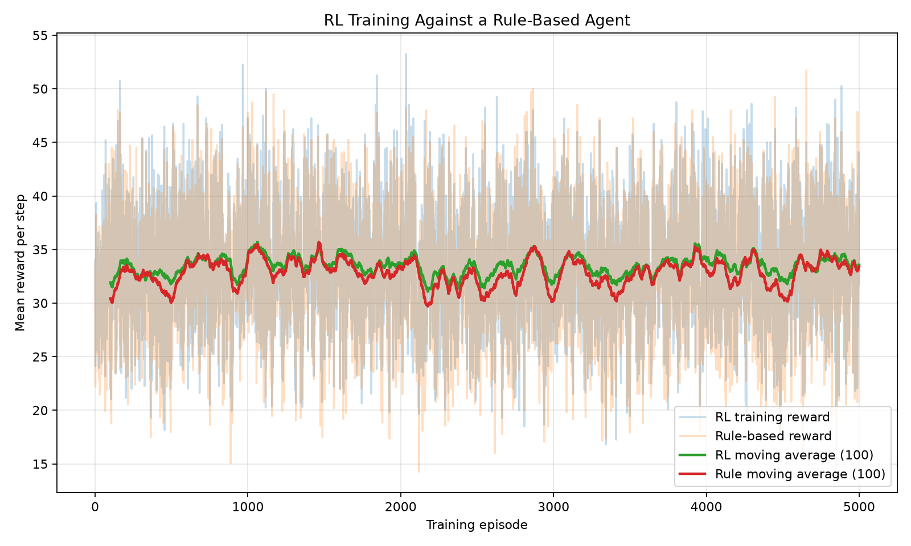
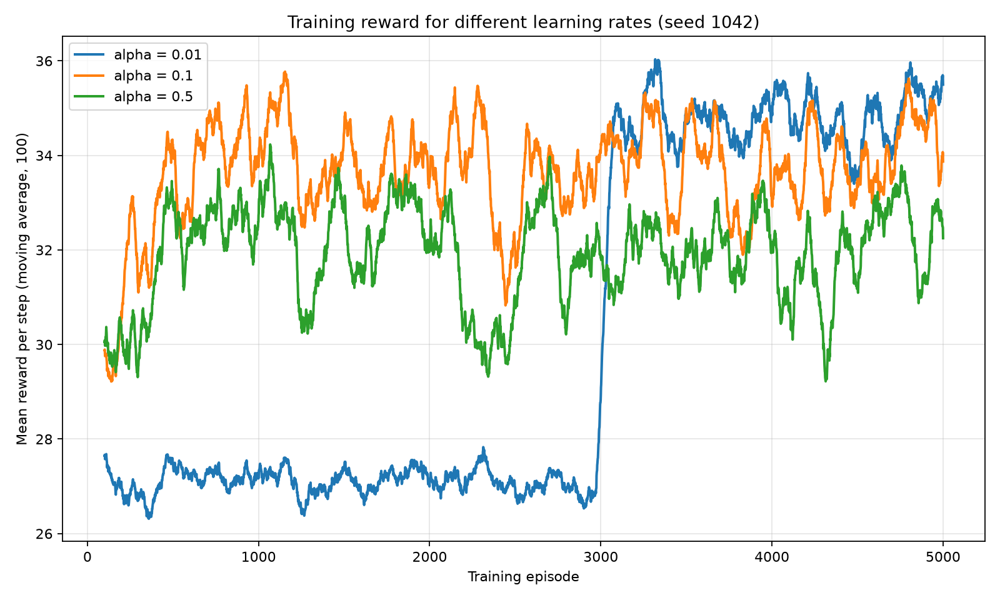
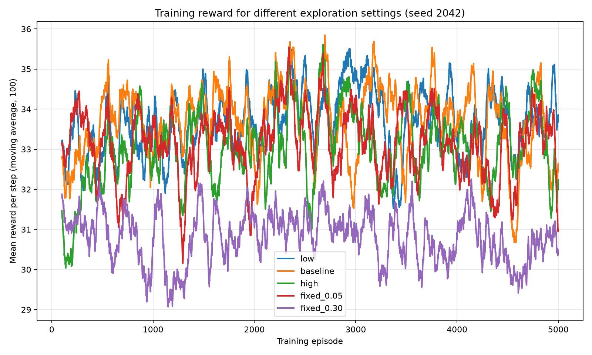
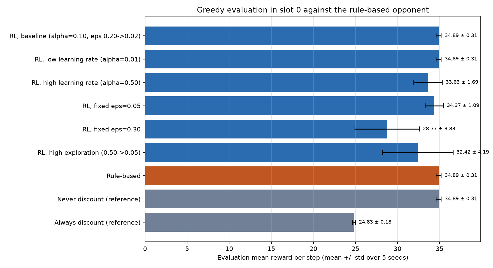
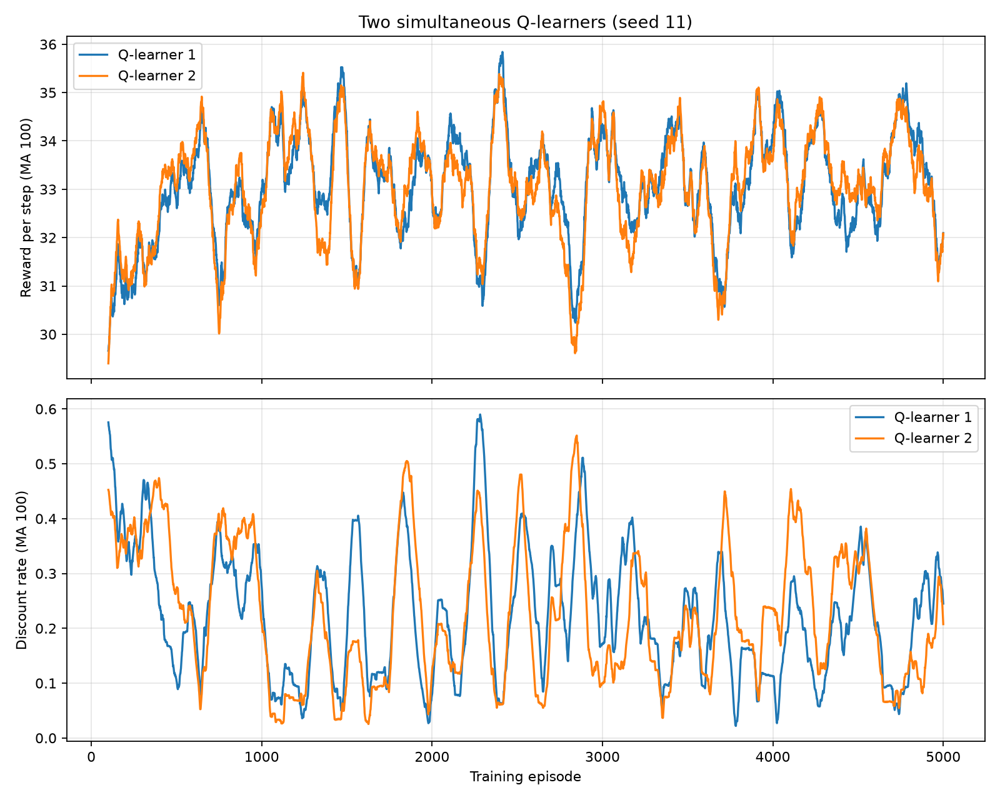
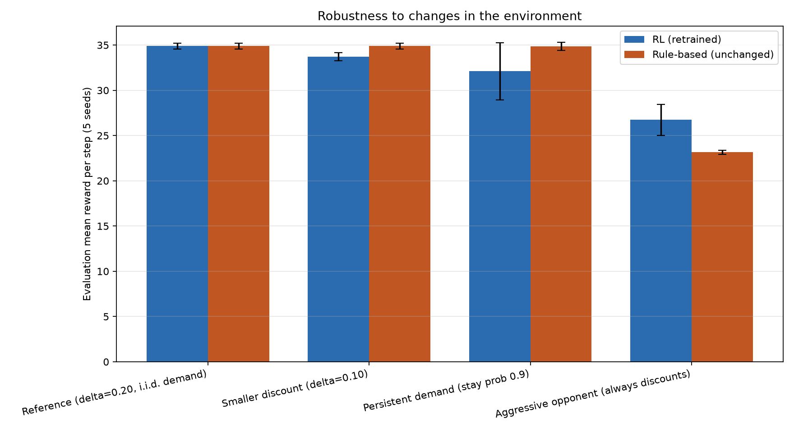

<div class="title-page">
<div class="big">Bài thực hành 02</div>
<div class="sub">Agent học tăng cường (Reinforcement Learning) và Agent dựa trên luật (Rule-Based)</div>
<div class="sub">Phát triển Hệ thống Thông minh, Năm học 2026–2027</div>
<table>
<tr><td><b>Sinh viên</b></td><td>Lý Hải Quân</td></tr>
<tr><td><b>Mã sinh viên</b></td><td>B23DCCN676</td></tr>
<tr><td><b>Lớp</b></td><td>05</td></tr>
<tr><td><b>Hình thức</b></td><td>Cá nhân</td></tr>
<tr><td><b>Ngày nộp</b></td><td>29/10/2026</td></tr>
<tr><td><b>Mã nguồn</b></td><td>github.com/lyhaiquan/AI-Agent-assigment</td></tr>
</table>
</div>

# 1. Giới thiệu và mục tiêu {.no-break}

Hai người bán cung cấp sản phẩm tương tự nhau trong một chợ thương mại điện tử mô phỏng. Ở mỗi bước thời gian, mỗi người bán quyết định có giảm giá 20 % hay không. Giảm giá làm tăng khả năng khách mua hàng, nhưng đồng thời làm giảm lợi nhuận trên mỗi đơn hàng và làm giảm tỉ lệ chuyển đổi của đối thủ.

Báo cáo so sánh hai cách xây dựng người bán:

- **Agent A, học tăng cường (RL).** Q-learning dạng bảng. Agent học giá trị của từng hành động từ lợi nhuận nhận được.
- **Agent B, dựa trên luật.** Một chính sách if-else cố định do lập trình viên viết. Chính sách này không bao giờ thay đổi.

Mục tiêu là mô hình hoá bài toán như một hệ đa agent, cài đặt cả hai agent, đo lường chúng theo một quy trình công bằng và có thể tái lập, và giải thích *vì sao* kết quả lại như vậy, kể cả những trường hợp việc học không giúp ích gì.

**Kết quả chính (chi tiết ở mục 5–7).**

1. Trong thị trường gốc, agent RL sau huấn luyện và agent dựa trên luật đạt **phần thưởng đánh giá giống hệt nhau** (34.89 ± 0.31 mỗi bước, trên 5 seed). Trên các trạng thái thực sự gặp phải, cả hai chính sách đều quy về "không bao giờ giảm giá". Tính toán giải tích ở mục 5.1 cho thấy đây là chính sách tốt nhất trước đối thủ này (kỳ vọng 35.0 mỗi bước).
2. Việc học khá mong manh. Learning rate cao (α = 0.5) hoặc khám phá nhiều (ε cố định 0.30) tạo ra chính sách giảm giá quá thường xuyên, mất 1–6 đơn vị mỗi bước.
3. Khi môi trường thay đổi, agent dựa trên luật không thể thích nghi. Trước đối thủ hung hăng luôn giảm giá, agent RL đạt **26.73** so với **23.16** của agent luật. Nhưng agent RL gốc cũng *thua* agent luật ở hai thị trường đã sửa đổi, vì trạng thái của nó không chứa hành động trước đó của chính nó.
4. Một Q-learner cải tiến, thêm hành động trước đó của chính mình vào trạng thái và dùng learning rate giảm dần, bằng agent luật ở nơi luật tốt và vượt agent luật ở nơi luật kém (mục 6, câu 10).

# 2. Môi trường và các agent

## 2.1 Môi trường

| Thành phần | Định nghĩa |
|---|---|
| Agent | 2 người bán, $i \in \{1,2\}$ (trong code: slot 0 = agent A, slot 1 = agent B) |
| Trạng thái cục bộ | $s_i(t) = (d_t, c_i(t))$, nhu cầu $d_t\in\{0,1\}$ và hành động trước đó của đối thủ $c_i(t)\in\{0,1\}$; 4 trạng thái |
| Hành động | $a_i(t)\in\{0 = \text{không giảm giá}, 1 = \text{giảm giá}\}$, chọn đồng thời |
| Số khách | $N_t = 10$ nếu $d_t = 0$, $N_t = 20$ nếu $d_t = 1$ |
| Tỉ lệ chuyển đổi | $p_i(t) = \operatorname{clip}(0.30 + 0.25 d_t + 0.15 a_i(t) - 0.10 a_{-i}(t),\ 0.05,\ 0.95)$ |
| Số đơn bán | $S_i(t) \sim \text{Binomial}(N_t, p_i(t))$ |
| Phần thưởng (lợi nhuận) | $r_i(t) = S_i(t)\,\big(P(1-\delta a_i(t)) - C\big)$ với $P = 10$, $C = 5$, $\delta = 0.20$ |
| Chuyển trạng thái | $d_{t+1}$ sinh i.i.d. với $P(d=1) = 0.5$ (không phụ thuộc hành động); $c_i(t+1) = a_{-i}(t)$ |
| Episode | 20 bước; mỗi episode bắt đầu với nhu cầu ngẫu nhiên và cả hai hành động trước đó = 0 |

```python
# ECommerceEnvironment.step (lõi của mô hình phần thưởng)
conversion = 0.30 + 0.25 * self.demand + 0.15 * own_action - 0.10 * competitor_action
conversion = float(np.clip(conversion, 0.05, 0.95))
sales = int(self.rng.binomial(customers, conversion))
effective_price = self.config.price * (1.0 - self.config.discount_rate * own_action)
profit = sales * (effective_price - self.config.unit_cost)
...
self.previous_actions = list(actions)   # trở thành c_i(t+1)
self.demand = self.next_demand()        # i.i.d. trong mô hình gốc
```

## 2.2 Agent A: Q-learning

Agent lưu một bảng $Q[d, c, a]$ gồm $2\times2\times2 = 8$ giá trị, chọn hành động theo $\varepsilon$-greedy khi huấn luyện, và cập nhật

$$Q(s_t,a_t) \leftarrow Q(s_t,a_t) + \alpha\Big[r_t + \gamma \max_{a'} Q(s_{t+1},a') - Q(s_t,a_t)\Big].$$

Ở bước cuối của episode, mục tiêu chỉ là $r_t$. $\varepsilon$ giảm theo từng episode: $\varepsilon_e = \max(\varepsilon_{\min}, \varepsilon_0 \cdot 0.995^{e})$, nên chạm mức sàn 0.02 sau khoảng 460 trên 5 000 episode.

```python
def learn(self, state, action, reward, next_state, terminal=False):
    old_value = self.q[demand, competitor_previous_action, action]
    target = reward if terminal else reward + self.gamma * np.max(self.q[next_demand, next_competitor_action])
    self.q[demand, competitor_previous_action, action] = old_value + self.alpha * (target - old_value)
```

## 2.3 Agent B: dựa trên luật

$$\pi^{\text{rule}}(d,c) = \begin{cases}0 & d = 0\\ 1 & d = 1,\ c = 1\\ 0 & d = 1,\ c = 0\end{cases}$$

```python
class RuleBasedAgent:
    def act(self, state, explore=False):
        demand, competitor_previous_action = state
        if demand == 0:
            return 0                                   # Luật 1: nhu cầu thấp -> không giảm giá
        elif demand == 1 and competitor_previous_action == 1:
            return 1                                   # Luật 2: đối thủ giảm giá -> giảm theo
        else:
            return 0                                   # Luật 3: còn lại -> không giảm giá
```

## 2.4 Vì sao đây là hệ đa agent

Phần thưởng của mỗi người bán phụ thuộc vào hành động *hiện tại* của người bán kia (số hạng $-0.10\,a_{-i}$), và quan sát tiếp theo của nó chứa hành động của người bán kia ($c_i(t+1) = a_{-i}(t)$). Không agent nào kiểm soát toàn bộ môi trường, và không agent nào thấy hành động của bên kia trước khi chọn. Đây là một trò chơi ngẫu nhiên hai người chơi, không phải một quá trình quyết định Markov một agent. Đặc biệt, đối thủ dựa trên luật *phản ứng* lại agent RL: nếu A giảm giá khi nhu cầu cao, B sẽ giảm giá ở bước nhu cầu cao tiếp theo. Chính phản ứng này chi phối phần lớn các kết quả dưới đây.

# 3. Thiết lập thí nghiệm

## 3.1 Tham số

| Tham số | Giá trị |
|---|---|
| Huấn luyện: episode × bước | 5 000 × 20 = 100 000 bước mỗi lần chạy |
| Đánh giá: episode × bước | 500 × 20 = 10 000 bước mỗi lần chạy |
| Learning rate α | 0.10 (thêm 0.01, 0.50) |
| Hệ số chiết khấu γ | 0.90 |
| Khám phá | ε 0.20 → 0.02, giảm 0.995 mỗi episode (cùng các phương án khác, thí nghiệm D) |
| Giá / chi phí / mức giảm | 10 / 5 / 20 % |
| Seed, baseline | môi trường 42; agent RL = seed + 10 000; môi trường đánh giá 500 042 |
| Seed, nhiều seed | huấn luyện 11, 22, 33, 44, 55; đánh giá = seed huấn luyện + 800 000 |
| Phần mềm | Python 3.14.2, NumPy 2.4.2, Matplotlib 3.11.1; toàn bộ chạy ≈ 14 phút trên CPU laptop |

## 3.2 Quy trình đánh giá

- **Pha đánh giá tách riêng.** Sau huấn luyện, bảng Q được đóng băng, ε = 0 (greedy), và đánh giá dùng seed môi trường khác với lúc huấn luyện.
- **Cùng vị trí, cùng đối thủ, cùng seed.** Code gốc báo cáo agent RL ở slot 0 và agent luật ở slot 1, nên hai agent đối mặt với *các đối thủ khác nhau*. Để so sánh công bằng, chúng tôi đánh giá thêm chính sách luật *ở slot 0*, gặp cùng đối thủ dựa trên luật, với cùng seed đánh giá (`run_rule_vs_rule`, `multi_seed_fixed`). Mọi con số "Rule-based" trong các bảng của chúng tôi là con số ở slot 0 này.
- **Nhiều seed.** Mỗi cấu hình trong bảng kết quả được huấn luyện và đánh giá trên 5 seed độc lập. Chúng tôi báo cáo trung bình và độ lệch chuẩn mẫu của phần thưởng đánh giá mỗi bước.

```python
def evaluate_pair(config, rl_agent, episodes=None, seed=900_000, opponent=None, names=("RL", "Rule-based")):
    env = ECommerceEnvironment(config, seed=seed)          # seed đánh giá riêng
    rule_agent = RuleBasedAgent() if opponent is None else opponent
    for episode in range(episodes):
        states = env.reset()
        for _ in range(config.steps_per_episode):
            rl_action = rl_agent.act(states[0], explore=False)   # greedy, không cập nhật Q
            rule_action = rule_agent.act(states[1])
            next_states, rewards, info = env.step([rl_action, rule_action])
            ...
```

## 3.3 Những thay đổi so với code gốc

Mọi thay đổi đều là bổ sung và được ghi chú ở đầu file. **Kết quả baseline gốc được tái lập chính xác.** Chúng tôi đã chạy file gốc chưa sửa và file của mình, và nhận được cùng các con số (RL 35.1275, luật 34.9685; nhiều seed: RL 34.8919 ± 0.3132, luật 34.9321 ± 0.2496).

1. `Config.demand_persistence` (mặc định `None` = nhu cầu i.i.d. như bản gốc) cho thí nghiệm nhu cầu Markov.
2. Thêm các đối thủ cố định `AlwaysDiscountAgent` và `NeverDiscountAgent`.
3. `evaluate_pair` nhận bất kỳ chính sách nào ở slot 0 và bất kỳ đối thủ nào ở slot 1.
4. Nhật ký huấn luyện ghi thêm tỉ lệ giảm giá của RL theo từng episode. Thí nghiệm learning rate và khám phá lưu thêm đường cong huấn luyện.
5. Thí nghiệm mới: khám phá với ε cố định, bảng kết quả 5 seed, hai agent cùng học, môi trường sửa đổi, agent cải tiến.

# 4. Kết quả

## 4.1 Thí nghiệm A: baseline (seed 42)

| Agent (đánh giá, 10 000 bước) | Tổng phần thưởng | Phần thưởng TB / bước | Số lần giảm giá | Số lần không giảm giá |
|---|---|---|---|---|
| RL (slot 0) | 351 275 | **35.1275** | 0 | 10 000 |
| Luật (slot 1, gặp RL) | 349 685 | 34.9685 | 0 | 10 000 |
| Luật ở slot 0 (gặp agent luật, cùng seed) | 351 275 | **35.1275** | 0 | 10 000 |

Bảng Q học được (`q_tables.txt`):

| Trạng thái $(d, c)$ | $Q(s,0)$ | $Q(s,1)$ | Hành động greedy | Có gặp khi đánh giá? |
|---|---|---|---|---|
| (0, 0) nhu cầu thấp, đối thủ không giảm giá | 228.30 | 178.85 | không giảm giá | có |
| (0, 1) nhu cầu thấp, đối thủ đã giảm giá | 177.99 | 207.21 | giảm giá | **không** |
| (1, 0) nhu cầu cao, đối thủ không giảm giá | 246.88 | 235.23 | không giảm giá | có |
| (1, 1) nhu cầu cao, đối thủ đã giảm giá | 211.42 | 242.96 | giảm giá | **không** |

**Quan sát.** Chính sách greedy chứa "giảm giá" ở hai trạng thái, nhưng agent không giảm giá lần nào khi đánh giá.

**Giải thích.** Mỗi episode bắt đầu với cả hai hành động trước đó = 0. Agent luật chỉ giảm giá sau khi agent RL đã giảm giá lúc nhu cầu cao, mà agent RL không bao giờ giảm giá ở các trạng thái $(d, 0)$. Vì vậy trạng thái $(0,1)$ và $(1,1)$ **không bao giờ xuất hiện** khi chơi greedy. Trên các trạng thái có xuất hiện, chính sách RL trùng với chính sách luật (không giảm giá). Cùng seed và cùng hành động sẽ cho cùng các lần rút ngẫu nhiên nhị thức, nên cả hai đạt đúng 35.1275. Khoảng chênh 0.16 trong kết quả gốc (35.13 so với 34.97) **không phải là khác biệt chính sách**. Hai con số đó thuộc về hai vị trí khác nhau với các lần rút doanh số ngẫu nhiên khác nhau.

Độ lớn của Q (≈ 200–250) phù hợp với γ = 0.9: phần thưởng không đổi 35 mỗi bước cho $35/(1-0.9) = 350$ nếu vô hạn bước, và nhỏ hơn ở đây vì episode dừng sau 20 bước.

## 4.2 Thí nghiệm B: quá trình học



| Episode huấn luyện | RL / bước | Đối thủ luật / bước | Tỉ lệ giảm giá RL | ε đầu cửa sổ |
|---|---|---|---|---|
| 1–500 | 32.55 | 31.63 | 0.295 | 0.200 → 0.017 |
| 501–1 000 | 33.85 | 33.54 | 0.111 | 0.020 |
| 1 001–2 000 | 33.91 | 33.42 | 0.130 | 0.020 |
| 2 001–3 000 | 33.04 | 32.15 | 0.226 | 0.020 |
| 3 001–4 000 | 33.48 | 32.94 | 0.160 | 0.020 |
| 4 001–5 000 | 33.65 | 33.10 | 0.157 | 0.020 |

**Quan sát.** Phần thưởng tăng trong khoảng 500 episode đầu khi ε giảm, sau đó **dao động quanh 33–34 mà không có xu hướng rõ ràng**. Độ lệch chuẩn theo episode khoảng 5.2 suốt quá trình. Phần thưởng huấn luyện luôn thấp hơn phần thưởng đánh giá greedy (35.13) khoảng 1.5, và tỉ lệ giảm giá khi huấn luyện (≈ 0.16) cao hơn nhiều so với ε/2 = 0.01.

**Giải thích.** Với ε = 0.02, agent thỉnh thoảng vẫn giảm giá ngẫu nhiên. Nếu việc này xảy ra lúc nhu cầu cao, đối thủ luật sẽ giảm giá ở bước nhu cầu cao tiếp theo. Agent RL khi đó rơi vào trạng thái $(d,1)$, nơi hành động greedy của nó là "giảm giá", và một cuộc chiến giá ngắn kéo dài cho đến khi gặp bước nhu cầu thấp. Những episode này kéo phần thưởng huấn luyện xuống. Khi đánh giá, mỗi episode bắt đầu ở $(d,0)$ với ε = 0 nên không bao giờ châm ngòi chiến tranh giá. Do đó đường cong phẳng và nhiễu này **không** chứng minh được sự hội tụ. Phần thưởng huấn luyện đo chính sách *đang khám phá*, còn đánh giá đo chính sách *greedy*.

## 4.3 Thí nghiệm C: learning rate (seed 1 042)



| α | Đánh giá / bước | Tỉ lệ giảm giá (đánh giá) | Huấn luyện, 1 000 ep. cuối (TB ± độ lệch) | Chính sách greedy $(0,0),(0,1),(1,0),(1,1)$ |
|---|---|---|---|---|
| 0.01 | 35.2475 | 0.000 | 34.86 ± 4.92 | 0, 0, 0, 1 |
| 0.10 | 35.2475 | 0.000 | 33.99 ± 5.19 | 0, 0, 0, 1 |
| 0.50 | 28.5085 | 0.405 | 31.91 ± 5.46 | 0, 0, **1**, 0 |

- **α = 0.01.** Phần thưởng huấn luyện nằm ở ≈ 27 trong 3 000 episode đầu rồi nhảy lên ≈ 35. Giá trị 27 đúng bằng giá trị giải tích của chính sách "chỉ giảm giá khi nhu cầu cao" (mục 5.1). Bước cập nhật nhỏ khiến agent bị kẹt lâu trong một vòng chiến tranh giá tự củng cố. Khi ước lượng đã được sửa, agent tìm ra chính sách tốt nhất và có phần thưởng huấn luyện ít nhiễu nhất.
- **α = 0.10.** Học nhanh (trong khoảng 500 episode) nhưng đường huấn luyện vẫn dao động ±1.5.
- **α = 0.50.** Mỗi con số doanh số nhiễu kéo Q đi một nửa quãng đường. Hành động greedy ở trạng thái then chốt (1, 0) thành *giảm giá*, làm mất ≈ 6.7 mỗi bước khi đánh giá.

Trên 5 seed (bảng 4.6), α = 0.01 và α = 0.10 cho kết quả đánh giá giống hệt nhau (34.89 ± 0.31). α = 0.50 cho 33.63 ± 1.69: trung bình thấp hơn và biến động giữa các seed gấp năm lần.

## 4.4 Thí nghiệm D: khám phá (seed 2 042)



| Thiết lập | ε đầu → min (hệ số giảm) | Huấn luyện, mọi ep. | Huấn luyện, 1 000 ep. cuối | Tỉ lệ giảm giá, 1 000 ep. cuối | Đánh giá / bước |
|---|---|---|---|---|---|
| low | 0.05 → 0.02 (0.999) | 33.67 | 33.65 | 0.158 | 35.1045 |
| baseline | 0.20 → 0.02 (0.995) | 33.67 | 33.24 | 0.209 | 35.1045 |
| high | 0.50 → 0.05 (0.995) | 33.03 | 33.14 | 0.206 | 35.1045 |
| cố định 0.05 | 0.05 (không giảm) | 33.12 | 32.71 | 0.225 | 35.1045 |
| cố định 0.30 | 0.30 (không giảm) | 30.81 | 30.63 | 0.411 | **27.4464** |

Với seed này, bốn thiết lập cho cùng kết quả đánh giá 35.1045: tất cả đều không giảm giá trên các trạng thái gặp phải. ε cố định 0.30 bị thiệt hai lần. Phần thưởng huấn luyện thấp hơn ≈ 3 vì 30 % hành động là ngẫu nhiên, và chính sách *greedy* cũng kém (giảm giá ở 3/4 trạng thái, tỉ lệ giảm giá khi đánh giá 0.81). Giảm giá ngẫu nhiên nhiều khiến đối thủ luật luôn ở chế độ "giảm theo", nên agent chủ yếu trải nghiệm các trạng thái mà đối thủ vừa giảm giá. Giá trị nó học được thuộc về chế độ chiến tranh giá đó và khái quát kém sang thị trường yên ổn lúc đánh giá. Trên 5 seed (bảng 4.6): cố định 0.05 đạt 34.37 ± 1.09, lịch high 32.42 ± 4.19, cố định 0.30 đạt 28.77 ± 3.83.

## 4.5 Thí nghiệm nhiều seed của code gốc

`multi_seed_summary.csv` (code gốc): RL 34.8919 ± 0.3132, "Rule-based" 34.9321 ± 0.2496. Con số của agent luật ở đây là agent ở slot 1 đang chơi *với agent RL*, nên đây không phải là so sánh hai chính sách ở cùng vị trí. Bảng 4.6 của chúng tôi dùng giá trị ở slot 0.

## 4.6 Thí nghiệm E: so sánh công bằng trên 5 seed (bảng kết quả)

Mọi dòng: huấn luyện với seed 11–55, đánh giá greedy ở slot 0 trước đối thủ dựa trên luật, seed đánh giá 800 011–800 055 (giống nhau cho mọi dòng).

| Agent / cấu hình | Phần thưởng TB / bước | Độ lệch chuẩn (5 seed) | Tỉ lệ giảm giá |
|---|---|---|---|
| RL, baseline (α = 0.10, ε 0.20 → 0.02) | 34.892 | 0.313 | 0.000 |
| RL, learning rate thấp (α = 0.01) | 34.892 | 0.313 | 0.000 |
| RL, learning rate cao (α = 0.50) | 33.630 | 1.692 | 0.201 |
| RL, khám phá khác: ε cố định 0.05 | 34.368 | 1.086 | 0.082 |
| RL, khám phá khác: ε cố định 0.30 | 28.773 | 3.828 | 0.499 |
| RL, khám phá khác: 0.50 → 0.05 | 32.422 | 4.185 | 0.266 |
| **Dựa trên luật** | **34.892** | **0.313** | **0.000** |
| Không bao giờ giảm giá (chính sách tham chiếu) | 34.892 | 0.313 | 0.000 |
| Luôn giảm giá (chính sách tham chiếu) | 24.829 | 0.180 | 1.000 |



**Lưu ý quan trọng.** Bốn dòng giống nhau đến chữ số cuối cùng. Đây không phải trùng hợp hay lỗi sao chép. Trên mọi seed, bốn chính sách này đều chọn "không giảm giá" ở mọi bước gặp phải. Với cùng seed đánh giá, chúng nhận cùng các lần rút doanh số nhị thức. Hiệu số theo cặp của chúng bằng đúng 0, và độ lệch chuẩn 0.313 đo **nhiễu môi trường giữa các seed**, không phải khác biệt về chất lượng chính sách. Agent RL baseline học được hành vi giống agent luật. Nó không học được hành vi tốt hơn, vì trong thị trường này không có hành vi nào tốt hơn (mục 5.1).

# 5. Phân tích bổ trợ

## 5.1 Phần thưởng kỳ vọng tính giải tích

Phần thưởng kỳ vọng một bước $E[r] = N\,p\,(P(1-\delta a) - C)$ của agent, biết hành động *hiện tại* của đối thủ (`expected_rewards.csv`):

| δ | Nhu cầu | Đối thủ hiện tại | $E[r \mid a=0]$ | $E[r \mid a=1]$ | Tốt hơn trước mắt |
|---|---|---|---|---|---|
| 0.20 | thấp | không giảm | 15.0 | 13.5 | không giảm giá |
| 0.20 | thấp | giảm | 10.0 | 10.5 | giảm giá |
| 0.20 | cao | không giảm | 55.0 | 42.0 | không giảm giá |
| 0.20 | cao | giảm | 45.0 | 36.0 | không giảm giá |
| 0.10 | thấp | không giảm | 15.0 | 18.0 | giảm giá |
| 0.10 | thấp | giảm | 10.0 | 14.0 | giảm giá |
| 0.10 | cao | không giảm | 55.0 | 56.0 | giảm giá |
| 0.10 | cao | giảm | 45.0 | 48.0 | giảm giá |

Phần thưởng dài hạn mỗi bước khi gặp **đối thủ dựa trên luật** (nhu cầu i.i.d. 50/50). Đối thủ giảm giá ở thời điểm $t$ chỉ khi $d_t = 1$ và *chúng ta* đã giảm giá ở $t-1$:

| Chính sách dừng của ta | δ = 0.20 | δ = 0.10 | Đo được (δ = 0.20) |
|---|---|---|---|
| Không bao giờ giảm giá | ½·15 + ½·55 = **35.0** | **35.0** | 34.89 (mọi lần chạy RL tốt, agent luật) |
| Chỉ giảm khi nhu cầu thấp | ½·13.5 + ½(½·45 + ½·55) = 31.75 | ½·18 + ½·50 = 34.0 | — |
| Chỉ giảm khi nhu cầu cao | ½·15 + ½(½·36 + ½·42) = 27.0 | ½·15 + ½(½·48 + ½·56) = 33.5 | ≈ 27 (α = 0.01, 3 000 ep. đầu) |
| Luôn giảm giá | ½·13.5 + ½·36 = 24.75 | ½·18 + ½·48 = 33.0 | 24.83 |

Các giá trị đo được khớp với tính tay trong phạm vi nhiễu lấy mẫu. Từ đó rút ra hai kết luận:

- Với δ = 0.20, **không bao giờ giảm giá là tối ưu** trước đối thủ này, và agent luật vốn đã chơi đúng như vậy ở mọi trạng thái đạt tới được. RL không thể vượt luật ở đây, chỉ có thể bằng.
- Với δ = 0.10, giảm giá tốt hơn *trong bước hiện tại* ở mọi trạng thái (+1 đến +4), nhưng về lâu dài vẫn thua: nó khiến đối thủ giảm giá theo ở bước nhu cầu cao kế tiếp, mất 8–11. Q-learner chỉ nhận ra điều này nếu trạng thái cho nó biết bước trước nó có giảm giá hay không, mà trạng thái gốc $(d, c)$ thì không có thông tin đó.

## 5.2 Trích đoạn code cho phần mở rộng

```python
class ImprovedQLearningAgent(QLearningAgent):
    def observe(self, env, states):
        if self.augmented:                       # (d, c, hành động trước của mình)
            return states[0] + (env.previous_actions[0],)
        return states[0]

    def learn(self, state, action, reward, next_state, terminal=False):
        index = state + (action,)
        self.visits[index] += 1
        alpha = max(0.005, 1.0 / self.visits[index] ** 0.6) if self.decaying_alpha else self.alpha
        target = reward if terminal else reward + self.gamma * np.max(self.q[next_state])
        self.q[index] += alpha * (target - self.q[index])
```

# 6. Trả lời mười câu hỏi

## Câu 1. Mô hình hoá agent và môi trường

- **Agent:** hai người bán. Agent A là Q-learner, agent B dựa trên luật. Ở câu 8 cả hai đều là Q-learner.
- **Môi trường:** thị trường. Nó sinh nhu cầu, chuyển giá của hai bên thành xác suất chuyển đổi, lấy mẫu doanh số và trả lợi nhuận.
- **Không gian trạng thái:** $S = \{0,1\}\times\{0,1\}$, tức (nhu cầu, hành động trước đó của đối thủ), 4 trạng thái mỗi agent. Trạng thái là *cục bộ*: agent không thấy hành động trước đó của chính mình, chính sách của đối thủ, hay nhu cầu tương lai.
- **Không gian hành động:** $A = \{0, 1\}$ (không giảm / giảm giá), chọn đồng thời.
- **Phần thưởng:** lợi nhuận $r_i = S_i\,(10(1-0.2a_i) - 5)$, $S_i\sim\text{Bin}(N_t, p_i)$.
- **Chuyển trạng thái:** $d_{t+1}$ i.i.d. Bernoulli(0.5); $c_i(t+1) = a_{-i}(t)$. Nhu cầu không phụ thuộc hành động. Phần đối thủ trong trạng thái do lựa chọn của agent kia quyết định hoàn toàn.

Đây là **hệ đa agent** vì (i) phần thưởng của mỗi agent phụ thuộc vào hành động đồng thời của agent kia qua số hạng $-0.10\,a_{-i}$; (ii) trạng thái tiếp theo của mỗi agent chính là hành động của agent kia; (iii) các agent có mục tiêu riêng (lợi nhuận của mình) và hành động mà không thấy lựa chọn hiện tại của nhau. Coi đối thủ là một phần cố định của môi trường chỉ đúng khi đối thủ thực sự cố định. Câu 8 cho thấy điều gì xảy ra khi không phải vậy.

## Câu 2. Quyết định dựa trên học và dựa trên luật

| Khía cạnh | Agent RL (Q-learning) | Agent dựa trên luật |
|---|---|---|
| Ra quyết định | $\arg\max_a Q(s,a)$ trên các giá trị đã học | if-else viết tay trên trạng thái |
| Sử dụng kinh nghiệm | Mỗi bước chuyển cập nhật một giá trị Q | Không; hành vi cố định từ lúc thiết kế |
| Khả năng thích nghi | Có thể học lại khi thị trường đổi (đối thủ hung hăng: 26.73 so với 23.16), nhưng chỉ với những gì trạng thái biểu diễn được | Không; lập trình viên phải viết lại luật (ví dụ việc giảm giá theo đối thủ mất 4.6 mỗi bước trước đối thủ luôn giảm giá) |
| Dữ liệu / tính toán | 100 000 bước huấn luyện mỗi lần chạy (vài giây trên CPU); kết quả phụ thuộc α, ε, seed | Không cần huấn luyện; O(1) mỗi quyết định |
| Tính dự đoán được | Thay đổi theo seed (độ lệch chuẩn tới 4.2 mỗi bước với thiết lập kém) | Tất định, dễ kiểm tra |

**Khi nào nên dùng luật:** một cửa hàng có chính sách giá rõ ràng, có quy định ("không bán dưới giá niêm yết trong mùa thấp điểm"), quyết định phải giải thích được cho quản lý hoặc kiểm toán, và có ít dữ liệu. Trong thị trường gốc của chúng tôi, luật vốn đã tối ưu và không cần huấn luyện gì.

**Khi nào nên dùng RL:** một sàn có nhiều đối thủ với chiến lược thay đổi (ví dụ có người bán mới hung hăng tham gia). Một agent liên tục cập nhật từ dữ liệu lợi nhuận có thể tìm ra phản ứng tốt nhất mà không cần lập trình viên suy luận lại luật. Thí nghiệm đối thủ hung hăng là một ví dụ nhỏ: agent RL học được "giảm giá khi nhu cầu thấp, giữ giá khi nhu cầu cao" (hơn luật 3.6 mỗi bước).

## Câu 3. Cập nhật Q-learning

$$Q(s,a) \leftarrow Q(s,a) + \alpha\big[\underbrace{r + \gamma\max_{a'}Q(s',a')}_{\text{mục tiêu TD}} - Q(s,a)\big]$$

Phần trong ngoặc là **sai số temporal-difference (TD)**: kết quả quan sát được (phần thưởng tức thời cộng giá trị chiết khấu của hành động tốt nhất tiếp theo) tốt hơn hay tệ hơn ước lượng hiện tại bao nhiêu. α quyết định hấp thụ bao nhiêu phần sai số đó. γ quyết định lợi nhuận tương lai được coi trọng thế nào so với hôm nay.

Với $Q(s,a) = 4$, $\alpha = 0.1$, $r = 6$, $\gamma = 0.9$, $\max_{a'}Q(s',a') = 5$:

1. Giá trị tương lai đã chiết khấu: $\gamma \max_{a'}Q(s',a') = 0.9 \times 5 = 4.5$
2. Mục tiêu TD: $r + 4.5 = 6 + 4.5 = 10.5$
3. Sai số TD: $10.5 - 4 = 6.5$
4. Bước cập nhật: $\alpha \times 6.5 = 0.1 \times 6.5 = 0.65$
5. Giá trị mới: $Q(s,a) = 4 + 0.65 = \mathbf{4.65}$

**Ý nghĩa.** Kết quả tốt hơn kỳ vọng nhiều (mục tiêu 10.5 so với ước lượng 4), nên ước lượng dịch *về phía* mục tiêu, nhưng chỉ đi 10 % quãng đường. Một lần may mắn không xoá được kinh nghiệm cũ. Nếu mục tiêu này cứ lặp lại, Q sẽ hội tụ về 10.5. Với α = 1, Q sẽ nhảy ngay tới đó và chịu toàn bộ nhiễu, đúng như những gì thấy với α = 0.5 ở câu 7.

## Câu 4. Khám phá và khai thác

ε-greedy chọn hành động ngẫu nhiên với xác suất ε (khám phá, để thu dữ liệu về các hành động chưa chắc giá trị) và chọn hành động greedy trong các trường hợp còn lại (khai thác, để thu phần thưởng). Kết quả từ mục 4.4 và bảng 4.6:

| Thiết lập | Huấn luyện (1 000 ep. cuối, seed 2 042) | Đánh giá, 5 seed |
|---|---|---|
| Giảm dần 0.20 → 0.02 (baseline) | 33.24 | 34.89 ± 0.31 |
| Cố định 0.05 | 32.71 | 34.37 ± 1.09 |
| Giảm dần 0.50 → 0.05 | 33.14 | 32.42 ± 4.19 |
| Cố định 0.30 | 30.63 | 28.77 ± 3.83 |

- **Khám phá quá nhiều** (cố định 0.30) bị thiệt hai lần. Khi huấn luyện, 30 % hành động là ngẫu nhiên (phần thưởng huấn luyện thấp hơn ≈ 3). Nó còn làm sai lệch *nội dung* được học: giảm giá ngẫu nhiên thường xuyên giữ đối thủ phản ứng ở chế độ chiến tranh giá, nên giá trị học được mô tả chế độ đó, và chính sách greedy giảm giá ở 3/4 trạng thái (đánh giá 27.45 với seed 2 042).
- **Ngừng khám phá quá sớm.** Khi ε cố định ở mức nhỏ, các hành động trông có vẻ tệ lúc đầu hiếm khi được thử lại, nên giá trị Q của chúng bị cũ. Trong các lần chạy của chúng tôi, phần bài toán thực sự gặp phải rất nhỏ (4 trạng thái × 2 hành động), nên ngay cả ε = 0.05 cũng tìm ra hành động đúng ở hầu hết các seed. Nhưng các lần chạy khám phá ít để lại các trạng thái không bao giờ gặp $(0,1)$ và $(1,1)$ với hành động greedy tuỳ ý (bảng Q, mục 4.1). Trong một thị trường phức tạp hơn, các trạng thái chưa được kiểm chứng như vậy sẽ thành lỗi quyết định thật sự.
- Lịch baseline hoạt động tốt nhất ở đây: khám phá nhiều lúc đầu, sau đó chủ yếu khai thác.

## Câu 5. Phần thưởng và mục tiêu kinh doanh

Giảm giá làm tỉ lệ chuyển đổi tăng 15 điểm phần trăm (nhiều người mua hơn) nhưng hạ giá từ 10 xuống 8 trong khi giá vốn vẫn là 5:

- Không giảm giá: lợi nhuận mỗi đơn $= 10 - 5 = \mathbf{5}$.
- Có giảm giá: giá $= 10 \times (1 - 0.20) = 8$, lợi nhuận mỗi đơn $= 8 - 5 = \mathbf{3}$ (−40 %).

Biên lợi nhuận giảm 40 %, nhưng tỉ lệ chuyển đổi chỉ tăng từ 0.30 lên 0.45 (+50 %) khi nhu cầu thấp và từ 0.55 lên 0.70 (+27 %) khi nhu cầu cao. Vì vậy giảm giá chỉ có lời khi nhu cầu thấp *và* đối thủ đang giảm giá cùng lúc (10.5 so với 10.0, mục 5.1). Nó còn khiêu khích đối thủ dựa trên luật. Đó là lý do chính sách học được gần như không bao giờ giảm giá.

**Thay đổi phần thưởng sẽ thay đổi hành vi.** Chúng tôi kiểm chứng trực tiếp bằng cách đặt δ = 0.10 (biên lợi nhuận 4 thay vì 3). Khi đó giảm giá thắng ở mọi so sánh một bước, và agent RL gốc giảm giá 56 % số lần (câu 9). Các phần thưởng kinh doanh hợp lý khác cũng sẽ đẩy chính sách theo những hướng tương tự:

- doanh thu hoặc thị phần ($r = S_i \cdot P_i$ hoặc $r = S_i$) sẽ khuyến khích giảm giá, vì doanh số tăng;
- phạt hàng tồn kho, hoặc thưởng khi có khách hàng mới, cũng sẽ có lợi cho giảm giá;
- phạt các giai đoạn "chiến tranh giá", hoặc tính giá trị thương hiệu dài hạn, sẽ khuyến khích giữ giá.

Agent tối ưu đúng con số mà nó được giao. Phần thưởng phải mã hoá mục tiêu kinh doanh thực sự, nếu không agent sẽ theo đuổi sai mục tiêu.

## Câu 6. Đánh giá hiệu năng

$\overline{R}_i = \frac{1}{T}\sum_t r_i(t)$ trên pha đánh giá greedy tách riêng ($T$ = 10 000 bước mỗi seed):

| Agent | Seed 42 (một lần chạy) | 5 seed, TB ± độ lệch |
|---|---|---|
| Agent RL (slot 0) | 351 275 / 10 000 = **35.13** | **34.89 ± 0.31** |
| Agent luật (slot 0, cùng seed & đối thủ) | 351 275 / 10 000 = **35.13** | **34.89 ± 0.31** |
| Đối thủ luật ở slot 1 (kết quả gốc) | 349 685 / 10 000 = 34.97 | 34.93 ± 0.25 |

(Hình: mục 4.6.) Khi đo công bằng, hai cách tiếp cận **hoà nhau**, và hành vi của chúng trên các trạng thái gặp phải là giống hệt.

**Vì sao một lần chạy là không đủ.**

1. **Nhiễu lấy mẫu.** Phần thưởng theo episode có độ lệch chuẩn ≈ 4.8. Độ lệch chuẩn giữa các seed của giá trị trung bình 10 000 bước là 0.31, lớn hơn khoảng chênh 0.16 mà một lần chạy đơn lẻ (35.13 so với 34.97) gợi ý.
2. **Biến động do huấn luyện.** Với một số thiết lập, bản thân chính sách học được thay đổi theo seed (α = 0.5: 33.6 ± 1.7; khám phá cao: 32.4 ± 4.2). Một seed may hoặc rủi có thể đảo ngược thứ hạng.
3. **Chỉ một thị trường.** Một lần chạy không nói gì về các thị trường khác. Ở câu 9, thứ hạng đảo chiều tuỳ theo đối thủ và mức giảm giá.

## Câu 7. Learning rate và độ ổn định

| α | Đánh giá seed 1 042 | Đánh giá 5 seed (TB ± độ lệch) | Độ lệch khi huấn luyện (1 000 ep. cuối) | Hành vi |
|---|---|---|---|---|
| 0.01 | 35.25 | 34.89 ± 0.31 | 4.92 | chậm: kẹt ở ≈ 27 trong 3 000 episode, sau đó là chính sách tốt và ổn định nhất |
| 0.10 | 35.25 | 34.89 ± 0.31 | 5.19 | nhanh và đủ tốt |
| 0.50 | 28.51 | 33.63 ± 1.69 | 5.46 | nhanh nhưng không ổn định; sai hành động greedy ở trạng thái (1, 0) |

α là trọng số của sai số TD mới nhất. Một giá trị Q xấp xỉ trung bình có trọng số giảm theo hàm mũ của các mục tiêu trước đó, với "trí nhớ hiệu dụng" ≈ 1/α bước chuyển: khoảng 100 với α = 0.01, 10 với α = 0.1, 2 với α = 0.5. Lợi nhuận có phân phối nhị thức, độ lệch chuẩn tới ≈ 11 mỗi bước khi nhu cầu cao. Với α = 0.5, ước lượng gần như chỉ là một hai mẫu gần nhất, nên khoảng cách giữa hai hành động (thường chỉ 1–13 đơn vị) bị nhiễu che lấp và hành động greedy cứ đổi qua đổi lại. Với α = 0.01, nhiễu được làm trơn, nhưng sửa một ước lượng sai từ sớm cần hàng nghìn lần cập nhật, chính là đoạn bằng phẳng ở mức 27 trên hình. α cao làm agent phản ứng nhanh hơn với thay đổi *thật* (hữu ích khi thị trường biến động) và nhạy hơn với nhiễu *ngẫu nhiên*. α thấp thì ngược lại. α giảm dần của agent cải tiến (câu 10) vừa học nhanh lúc đầu vừa ít nhiễu về sau.

## Câu 8. Tương tác đa agent và tính không dừng

Agent kia ảnh hưởng tới agent $i$ theo hai cách: qua **phần thưởng**, vì hành động giảm giá hiện tại của nó làm $p_i$ giảm 0.10 (≈ −10 lợi nhuận khi nhu cầu cao), và qua **quan sát**, vì hành động của nó trở thành $c_i(t+1)$. Một đối thủ có phản ứng như agent luật còn làm tương lai của $i$ phụ thuộc vào hành động trước đó của chính $i$, điều mà $i$ không quan sát được.

Khi **cả hai agent cùng học**, chính sách của mỗi bên là một phần môi trường của bên kia, nên phân phối chuyển trạng thái và phần thưởng mà mỗi agent đối mặt liên tục thay đổi. Đảm bảo hội tụ của Q-learning giả định một MDP dừng, mà bài toán này thì không dừng. Mỗi agent đuổi theo một mục tiêu di động, và cặp agent có thể dừng ở những hành vi chung khác nhau tuỳ vào lịch sử ngẫu nhiên ban đầu.

**Thí nghiệm (Mở rộng D).** Hai Q-learner độc lập với siêu tham số giống nhau, huấn luyện đồng thời trên 5 seed, sau đó đánh giá greedy với nhau:

| Seed | Learner 1 | Learner 2 | Tỉ lệ giảm giá (1 / 2) | Kết cục |
|---|---|---|---|---|
| 11 | 34.74 | 34.83 | 0.00 / 0.00 | cả hai giữ giá |
| 22 | 33.06 | 33.06 | 0.49 / 0.49 | cả hai giảm giá khi nhu cầu thấp |
| 33 | 29.86 | 29.08 | 0.51 / 0.76 | chiến tranh giá |
| 44 | 35.12 | 35.08 | 0.00 / 0.00 | cả hai giữ giá |
| 55 | 34.60 | 34.74 | 0.00 / 0.00 | cả hai giữ giá |



Cùng thuật toán và cùng thiết lập nhưng cho ra ba kết cục khác nhau về chất. Ba seed dừng ở "cả hai giữ giá" (≈ 35, kết cục gần giống thông đồng). Hai seed bị khoá vào trạng thái cân bằng giảm giá và mỗi bên mất tới 6 mỗi bước. Tỉ lệ giảm giá khi huấn luyện của learner 1 gần như không giảm (trung bình các seed 0.31 ở 500 episode đầu so với 0.25 ở 500 episode cuối), nên các agent tiếp tục làm nhiễu lẫn nhau rất lâu sau khi ε đã chạm mức sàn.

**Các thay đổi giúp nghiên cứu vấn đề này:** (a) đóng băng một learner trong K episode rồi đến learner kia (phản ứng tốt nhất luân phiên), và đo xem chính sách chung có ngừng thay đổi không; (b) đưa *tần suất* hành động gần đây hoặc danh tính của đối thủ vào trạng thái; (c) ghi lại chính sách greedy chung mỗi 100 episode để đo tần suất thay đổi; (d) so sánh Q-learning độc lập với một joint-action learner, tức học $Q(s, a_i, a_{-i})$.

## Câu 9. Hạn chế và độ bền vững

Hạn chế của mô phỏng gốc:

1. **Trạng thái không đầy đủ.** Agent không quan sát hành động trước đó của chính mình, mặc dù đối thủ luật phản ứng với nó. Vì vậy bài toán không có tính Markov đối với agent học (mục 5.1).
2. **Nhu cầu i.i.d.** Nhu cầu không có tính lưu trì, tính mùa vụ hay phụ thuộc vào giá, nên "nhu cầu đang cao" không nói gì về bước tiếp theo.
3. **Mô hình chuyển đổi mang tính minh hoạ.** Công thức tuyến tính, cộng tính, chỉ một mức giảm giá, khách hàng đồng nhất, không có khách chuyển giữa các cửa hàng (giảm giá của đối thủ *làm giảm* chuyển đổi của ta nhưng khách hàng không được bảo toàn khi chuyển sang họ).
4. **Đối thủ cố định, đơn giản.** Đối thủ khi huấn luyện luôn là cùng một agent luật. Chính sách học được chỉ là phản ứng tốt nhất với đúng đối thủ đó.
5. **Episode ngắn và bị reset.** Mỗi episode reset về "không ai giảm giá". Điều này che giấu các trạng thái chiến tranh giá khi đánh giá và tạo ra một điểm kết thúc nhân tạo ở bước 20.
6. **Phương pháp dạng bảng.** Không mở rộng được cho giá liên tục, nhiều đối thủ hay đặc trưng phong phú.

**Các sửa đổi đã cài đặt (Mở rộng E).** Trong mỗi kịch bản, agent RL được *huấn luyện lại* trong môi trường mới. Agent luật giữ nguyên. Cả hai được đánh giá ở slot 0, 5 seed.

| Kịch bản | RL (Q-learner gốc) | Dựa trên luật | RL − Luật | Tỉ lệ giảm giá RL |
|---|---|---|---|---|
| Gốc (δ = 0.20, nhu cầu i.i.d.) | 34.89 ± 0.31 | 34.89 ± 0.31 | 0.00 | 0.00 |
| Giảm giá ít hơn (δ = 0.10) | 33.72 ± 0.43 | 34.89 ± 0.31 | **−1.17** | 0.56 |
| Nhu cầu lưu trì (giữ nguyên với xác suất 0.9) | 32.11 ± 3.16 | 34.87 ± 0.46 | **−2.76** | 0.40 |
| Đối thủ hung hăng (luôn giảm giá) | 26.73 ± 1.71 | 23.16 ± 0.23 | **+3.57** | 0.50 |



**Tác động.**

- **Đối thủ hung hăng.** Luật khiến agent giảm giá theo đối thủ khi nhu cầu cao (36 thay vì 45). Agent RL học được gần đúng phản ứng tốt nhất: giảm giá khi nhu cầu thấp (10.5 > 10), giữ giá khi nhu cầu cao (45 > 36). Theo lý thuyết chính sách này đạt 27.75; đo được 26.73. Ở đây việc học rõ ràng có ích.
- **δ = 0.10.** Agent RL giảm giá 56 % số lần vì mọi so sánh một bước đều nghiêng về giảm giá. Về lâu dài nó mất 1.17 mỗi bước, vì nó kích hoạt việc đối thủ giảm giá theo (mục 5.1: "luôn giảm giá" = 33.0 so với "không bao giờ" = 35.0). Agent luật không bị ảnh hưởng vì luật của nó tình cờ không giảm giá ở đây.
- **Nhu cầu lưu trì.** Chính sách tối ưu vẫn là "không bao giờ giảm giá" (35.0 theo lý thuyết), nhưng Q-learner kém hơn và biến động hơn nhiều (±3.16). Nhu cầu giữ nguyên trong thời gian dài nghĩa là mỗi episode có ít lần đổi trạng thái hơn, nên cùng vấn đề quan sát không đầy đủ xuất hiện thường xuyên hơn.

**Diễn giải (quan sát và giải thích).** Quan sát: agent RL gốc chỉ thắng luật khi đối thủ thay đổi, và thua ở hai thị trường thay đổi khác. Giải thích (giả thuyết, được kiểm tra ở câu 10): trạng thái của nó không biểu diễn được phản ứng của đối thủ với hành động trước đó của chính nó, và α = 0.1 cố định khiến giá trị Q quá nhiễu để phân biệt các chênh lệch nhỏ giữa hai hành động.

## Câu 10. Thiết kế agent thông minh tốt hơn

**Agent đề xuất: Q-learner "nhận biết phản ứng"** (`ImprovedQLearningAgent`).

| Thành phần | Thiết kế |
|---|---|
| Trạng thái | $(d_t,\ c_i(t),\ a_i(t-1))$: nhu cầu, hành động trước đó của đối thủ **và hành động trước đó của chính mình** (8 trạng thái, 16 giá trị Q) |
| Hành động | {không giảm giá, giảm giá} (có thể mở rộng thành nhiều mức giảm giá) |
| Phần thưởng | Lợi nhuận như cũ (doanh nghiệp có thể thêm phạt cho bước chiến tranh giá hoặc một số hạng giá trị vòng đời khách hàng) |
| Phương pháp học | Q-learning, γ = 0.9, ε 0.20 → 0.02, **learning rate theo số lần thăm** $\alpha(s,a) = \max(0.005,\ n(s,a)^{-0.6})$ |
| Đánh giá | Greedy, đóng băng bảng Q, seed riêng, slot 0, 5 seed, **4 môi trường** (gốc, δ = 0.10, nhu cầu lưu trì, đối thủ hung hăng) |

Lý do. Trạng thái mở rộng làm bài toán có tính Markov đối với mọi đối thủ phản ứng theo hành động trước đó (như agent luật). α giảm dần làm trơn nhiễu nhị thức của phần thưởng mà vẫn học nhanh lúc đầu.

**Kiểm tra độ bền vững (Mở rộng F, đã cài đặt).** Một thí nghiệm ablation tách riêng hai thay đổi. Phần thưởng đánh giá mỗi bước, trung bình ± độ lệch chuẩn trên 5 seed:

| Kịch bản | RL gốc | Dựa trên luật | Chỉ mở rộng trạng thái | Chỉ α giảm dần | **Cải tiến (cả hai)** | Chính sách tốt nhất (giải tích) |
|---|---|---|---|---|---|---|
| Gốc (δ = 0.20) | 34.89 ± 0.31 | 34.89 ± 0.31 | 32.32 ± 2.56 | 34.89 ± 0.31 | **34.89 ± 0.31** | 35.00 |
| Giảm giá ít hơn (δ = 0.10) | 33.72 ± 0.43 | 34.89 ± 0.31 | 33.91 ± 0.35 | 33.47 ± 0.32 | **34.75 ± 0.21** | 35.00 |
| Nhu cầu lưu trì | 32.11 ± 3.16 | 34.87 ± 0.46 | 33.67 ± 2.04 | 34.41 ± 0.94 | **34.75 ± 0.50** | 35.00 |
| Đối thủ hung hăng | 26.73 ± 1.71 | 23.16 ± 0.23 | 27.15 ± 1.09 | 27.62 ± 0.18 | **27.56 ± 0.17** | 27.75 |
| **Regret trung bình** (so với tối ưu giải tích) | 1.33 | 1.24 | 1.43 | 0.59 | **0.20** | 0 |
| **Regret xấu nhất** | 2.89 | 4.59 | 2.68 | 1.53 | **0.25** | 0 |

**Quan sát.**

- Agent cải tiến cách tối ưu giải tích không quá 0.25 mỗi bước ở cả bốn môi trường. Đây là biến thể duy nhất không bao giờ kém rõ rệt so với agent luật, và tốt hơn rõ rệt trước đối thủ hung hăng (+4.4). Độ lệch chuẩn giữa các seed của nó cũng thấp nhất hoặc gần thấp nhất ở mọi dòng.
- **Chỉ một thay đổi là không đủ.** Chỉ dùng α giảm dần thì giải quyết được vấn đề nhiễu (nhu cầu lưu trì, đối thủ hung hăng) nhưng vẫn thất bại với δ = 0.10 (33.47, tỉ lệ giảm giá 0.77). Ở đó lợi ích một bước của giảm giá là có thật, và chỉ đặc trưng hành-động-trước-đó-của-mình mới giúp agent thấy được sự trả đũa mà nó gây ra. Chỉ mở rộng trạng thái thì lại *kém hơn* bản gốc trong thị trường gốc (32.32 ± 2.56): 16 giá trị Q với α = 0.1 cố định thì mỗi giá trị được cập nhật ít hơn và nhiễu hơn.
- Thí nghiệm ablation này ủng hộ lời giải thích ở câu 9 (quan sát không đầy đủ + cập nhật nhiễu) mạnh hơn so với chỉ riêng kết quả câu 9. Tuy vậy, đây vẫn là bằng chứng từ một trình mô phỏng với 5 seed, không phải chứng minh.

**Làm sao kết luận "bền vững hơn".** Một agent bền vững hơn nếu, trên một *tập* môi trường và seed, (i) phần thưởng trung bình trong trường hợp xấu nhất cao hơn, (ii) regret trung bình so với chính sách tốt nhất ở từng môi trường thấp hơn, và (iii) độ lệch chuẩn giữa các seed thấp hơn. Việc so sánh nên ghép cặp trên cùng các seed, dùng paired t-test hoặc bootstrap trên hiệu số theo từng seed so với cả hai agent tham chiếu. Các kiểm tra thêm: (a) đối thủ chưa gặp khi huấn luyện (tit-for-tat, ngẫu nhiên, một đối thủ cũng học như ở câu 8); (b) thay đổi chế độ giữa chừng (đối thủ chuyển từ luật sang hung hăng sau 2 500 episode) để đo thời gian thích nghi lại; (c) quét độ nhạy theo δ và các hệ số chuyển đổi.

# 7. Thảo luận, hạn chế và đề xuất cải tiến

- **Agent dựa trên luật nhất quán, nhưng chỉ tốt bằng các luật của nó.** Trong thị trường gốc, luật tình cờ tối ưu khi gặp chính nó (không giảm giá ở các trạng thái đạt tới được) và không có cách học nào vượt được. Trước một đối thủ hung hăng, cùng bộ luật đó mất 4.6 mỗi bước so với phản ứng tốt nhất. Điểm yếu của nó không phải là nhiễu mà là không có cơ chế nào để nhận ra điều đó.
- **Việc học không đảm bảo tối ưu.** Q-learner gốc bằng agent luật trong thị trường gốc, nhưng cũng học ra chính sách *kém hơn* khi α hoặc ε được đặt không tốt (bảng 4.6) và ở hai thị trường sửa đổi (câu 9). Việc học hiệu quả khi trạng thái chứa đủ thông tin quan trọng và ước lượng đủ chính xác. Thí nghiệm ablation ở câu 10 cho thấy khắc phục hai điều kiện này xoá được phần lớn khoảng cách.
- **Biến động ngẫu nhiên lớn ngay cả với chính sách cố định.** Cùng chính sách "không bao giờ giảm giá" đạt từ 34.6 đến 35.3 mỗi bước chỉ do seed khác nhau. Chênh lệch 0.16 trong một lần chạy (kết quả gốc) chỉ là nhiễu.
- **Hai agent cùng học ảnh hưởng lẫn nhau.** Với hai Q-learner, kết cục dao động từ "cả hai giữ giá" (≈ 35) đến chiến tranh giá (≈ 29) chỉ tuỳ theo seed.
- **Hiệu năng huấn luyện và đánh giá.** Phần thưởng huấn luyện (≈ 33.6) luôn thấp hơn phần thưởng đánh giá (≈ 35.1). Khoảng chênh đến từ việc khám phá và các cuộc chiến giá mà nó gây ra, không phải từ một chính sách kém hơn. Ngược lại, đường huấn luyện tốt cũng không đảm bảo chính sách greedy tốt (ε cố định 0.30).

**Cải tiến tiếp theo:** nhiều mức giảm giá hoặc giá liên tục với xấp xỉ hàm; nhu cầu phản ứng theo giá; khách hàng không đồng nhất và tồn kho; huấn luyện với một *quần thể* đối thủ (luật, hung hăng, đang học) để chính sách khái quát tốt hơn; mặc định báo cáo khoảng tin cậy và kiểm định ghép cặp.

# 8. Kết luận

Chúng tôi đã cài đặt một mô phỏng thương mại điện tử hai người bán, một agent Q-learning dạng bảng và một agent dựa trên luật, rồi so sánh chúng bằng quy trình đánh giá tách riêng, greedy, nhiều seed, trong đó hai chính sách đứng cùng vị trí và gặp cùng đối thủ. Trong thị trường gốc, hai cách tiếp cận **hoà nhau ở mức 34.89 ± 0.31 mỗi bước**: Q-learner tự tìm lại chính sách của agent luật, vốn là tối ưu về mặt giải tích trước đối thủ này (35.0). Việc học chỉ thể hiện giá trị khi môi trường khác với những gì luật giả định (đối thủ hung hăng: +3.6 mỗi bước). Agent học gốc cũng có những điểm yếu rõ ràng: nhạy với α và ε, thất bại ở hai thị trường sửa đổi, và kết cục khó đoán khi hai agent cùng học. Phần lớn các thất bại này bắt nguồn từ hai nguyên nhân: trạng thái thiếu hành động trước đó của chính agent, và cập nhật nhiễu với α cố định. Một agent khắc phục cả hai điều này tốt ngang luật ở nơi luật đúng và tốt hơn ở nơi luật sai. Bài học chung: thứ hạng giữa hai cách tiếp cận phụ thuộc vào môi trường, cách thiết kế trạng thái và quy trình đánh giá. Vì vậy một so sánh cẩn thận cần có mốc tham chiếu giải tích, seed ghép cặp và nhiều môi trường, chứ không chỉ một đường cong huấn luyện.

# 9. Tài liệu tham khảo

1. Tài liệu môn học: *Laboratory Experiment 02 – Reinforcement-Learning-Based Agents versus Rule-Based Agents* và *AGENT02: Python Implementation*, Intelligent System Development, 2026–2027.
2. Slide bài giảng: *Multi-Agent Systems*, 20/10/2026.
3. *A Gentle Introduction to Reinforcement Learning* (tài liệu đọc của môn học).
4. R. S. Sutton và A. G. Barto, *Reinforcement Learning: An Introduction*, 2nd ed., MIT Press, 2018 (Q-learning, ε-greedy, điều kiện về bước cập nhật).
5. L. Buşoniu, R. Babuška và B. De Schutter, "A comprehensive survey of multiagent reinforcement learning," *IEEE Trans. SMC-C*, 38(2), 2008 (tính không dừng của các agent học độc lập).
